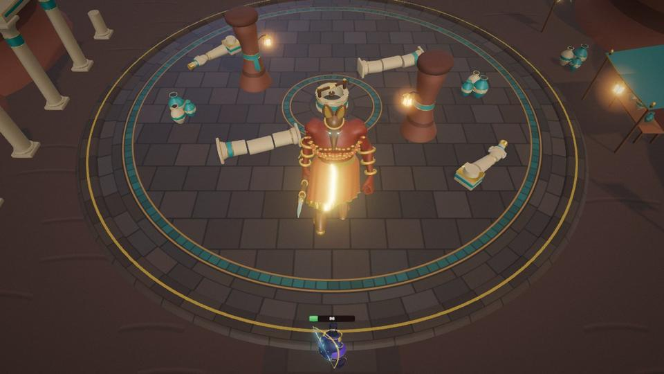
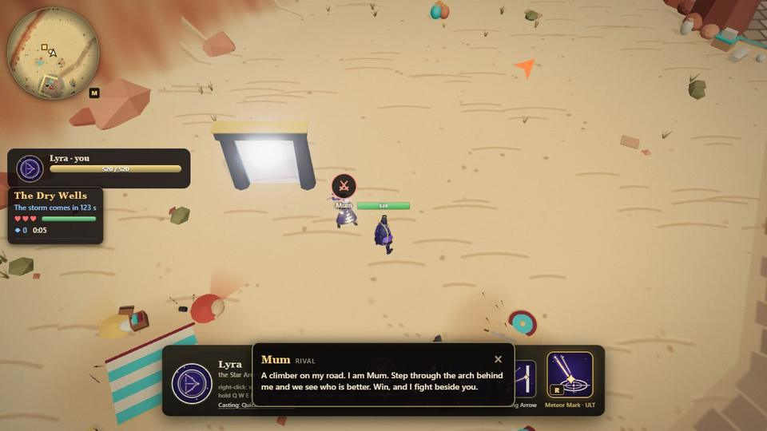
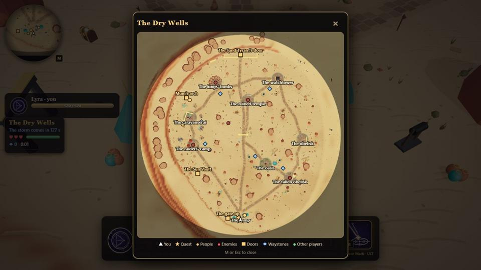
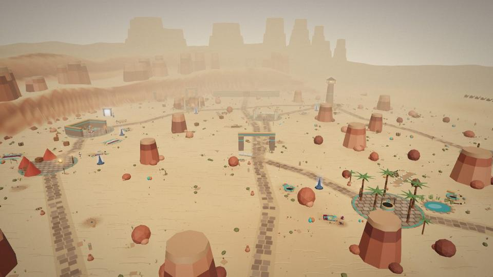

# Floor 27: The Dry Wells

Plays clean: cleared, no console error, every spot reachable; the caravan, the rival (Mum), the trial, the Sand Tyrant (the Red Jackal's model, tinted) and the gate (Nyx; second try) all played.

## Measured

- Reachable from the camp: 34030 m²; 58 spots of the floor's data, 0 cut off
- Props probe: 3 float, 4 gap, 21 buried, 2 in cover (each looked at; see below)
- Grass and small things on ground steeper than 31°: 0
- Packs table for the open world (server/climb-packs.mjs): matches
- Route bot (Lyra): cleared in 2126 game s, every checkpoint reached; 59 kills, 1 falls, stars 1101; ruler tries 1, gate tries 2; page errors 0
- Ruler: The Sand Tyrant (Every grain obeys), model models/tower/sands_jackal_v4.glb, loaded yes after 1644 ms of real time
- Frame check at the busiest spot (-57, 25), 6 units awake: median 3.5, 4.1, 3.6 ms, p95 5.4, 6.2, 6 ms (desktop, machine shared: rough)
- Console errors while taking the pictures: 0

## Found

- **ok: The shut lair holds.** Checked because a picture run seemed to start the ruler early (it was the run's own door, at the end): from five spots outside, on floors 2, 12, 22 and 27, a hero walking at the shut lair never starts its fight; the door only opens to the quest (scenery.ts `ready`). On floors 2, 22 and 27 the hero can walk round the end of the shut wall and stand on the door's spot; nothing happens there.
- **ok: The Sand Tyrant hits hard early.** A hero who stands still in his hall falls in about 7 s (the bot, fighting, won with nearly all its health): a boss, not a fault.
- **ok: Props.** A mesa past the north edge on its own high ground, the lair wall's gold edge into the dune, crates on the rim's slope, red rocks a little sunk.

## Not checked

- the shared packs online
- buying at the trader (card and prices shown)

## Pictures

  
The Sand Tyrant

  
Mum, the rival

  
The M map

  
From the south edge

