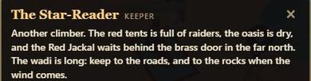
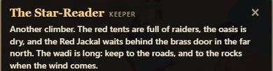
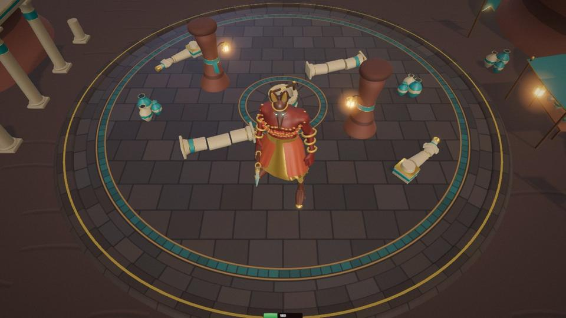
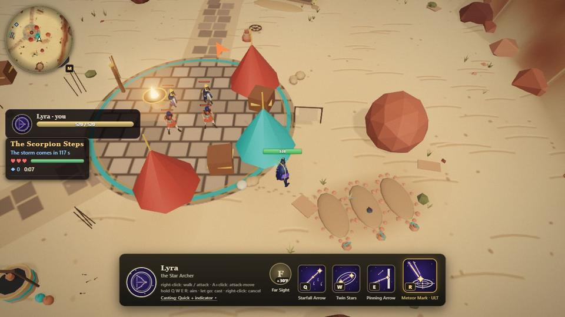
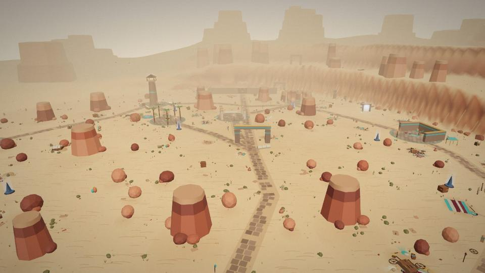

# Floor 28: The Scorpion Steps

Clean but for one word: cleared with four stars and no fall, no console error, every spot reachable; the caravan, the rival (Auriel), the trial, the Red Jackal (own model) and the gate (Isolde) all played.

## Measured

- Reachable from the camp: 33938 m²; 58 spots of the floor's data, 0 cut off
- Props probe: 4 float, 2 gap, 25 buried, 2 in cover (each looked at; see below)
- Grass and small things on ground steeper than 31°: 1
- Packs table for the open world (server/climb-packs.mjs): matches
- Route bot (Lyra): cleared in 1824 game s, every checkpoint reached; 58 kills, 0 falls, stars 1111; ruler tries 1, gate tries 1; page errors 0
- Ruler: The Red Jackal (It runs the wadi), model models/tower/sands_jackal_v4.glb, loaded yes after 1545 ms of real time
- Frame check at the busiest spot (52, 32), 6 units awake: median 2.7, 3, 3 ms, p95 4.3, 5.1, 5.5 ms (desktop, machine shared: rough)
- Console errors while taking the pictures: 0

## Found

- **fixed: “The red tents is full of raiders”.** As on the Sea's floor 4: the keeper's greeting put “is” after a plural place. The Sands' maker now says “are” for a name ending in s (gen/sands.ts; floors 22 to 30 re-baked, only floor 28's line changed).
  -  Before
  -  After
- **ok: Props.** Shrubs on the high rim (a few cm), crates on the rim's slope, red rocks a little sunk.

## Not checked

- the shared packs online
- buying at the trader (card and prices shown)

## Pictures

  
The Red Jackal

  
The red tents' pack

  
From the south edge

