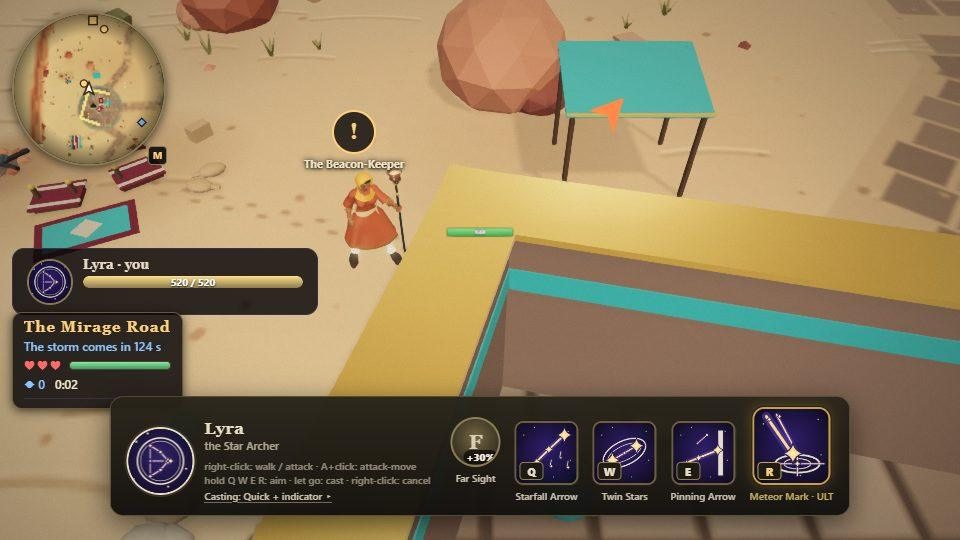
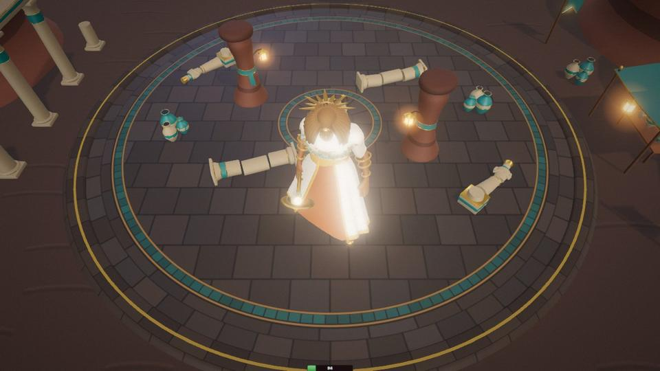
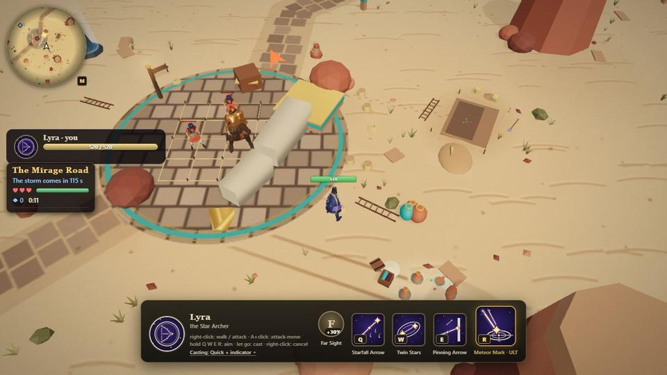
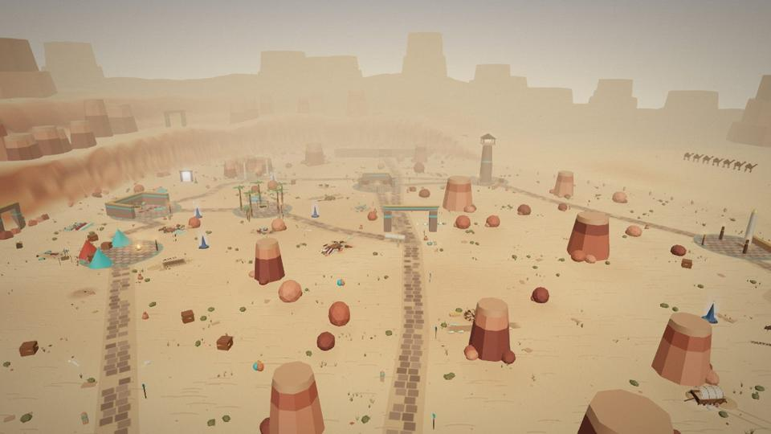

# Floor 29: The Mirage Road

Clean, and the longest floor so far: the bot's first run ran out of its 2400 game seconds just before the gate (everything else done); given 3200 it cleared in 2241 s with all four stars and no fall, under the floor's own par (2332 s). No console error, every spot reachable; the caravan, the rival (Fenna), the trial, the Sun-Eater (the Sphinx's model, tinted) and the gate (Brannoc) all played.

## Measured

- Reachable from the camp: 34051 m²; 55 spots of the floor's data, 0 cut off
- Props probe: 1 float, 4 gap, 34 buried, 2 in cover (each looked at; see below)
- Grass and small things on ground steeper than 31°: 0
- Packs table for the open world (server/climb-packs.mjs): matches
- Route bot (Lyra): cleared in 2241 game s, every checkpoint reached; 65 kills, 0 falls, stars 1111; ruler tries 1, gate tries 1; page errors 0
- Ruler: The Sun-Eater (It swallowed noon once), model models/tower/sands_sphinx_v4.glb, loaded yes after 1554 ms of real time
- Frame check at the busiest spot (-55, 27), 6 units awake: median 3.3, 3.6, 3.9 ms, p95 5.1, 6, 6.3 ms (desktop, machine shared: rough)
- Console errors while taking the pictures: 0

## Found

- **ok: The Beacon-Keeper behind a wall.** In the first picture only her mark showed, over the caravanserai's roof. She stands on the sand beside its wall (the probe finds no person in cover).
  -  The Beacon-Keeper beside the wall
- **ok: Packs and props.** The tombs' and the mud fort's packs slept through the bot's route; the probe: the lair wall's gold edge into the dune, crates on the rim's slope, red rocks a little sunk.

## Not checked

- the shared packs online
- buying at the trader (card and prices shown)

## Pictures

  
The Sun-Eater

  
The fallen obelisk's pack

  
From the south edge

