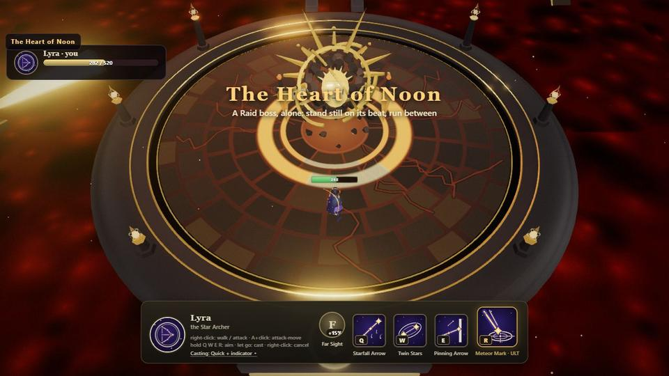
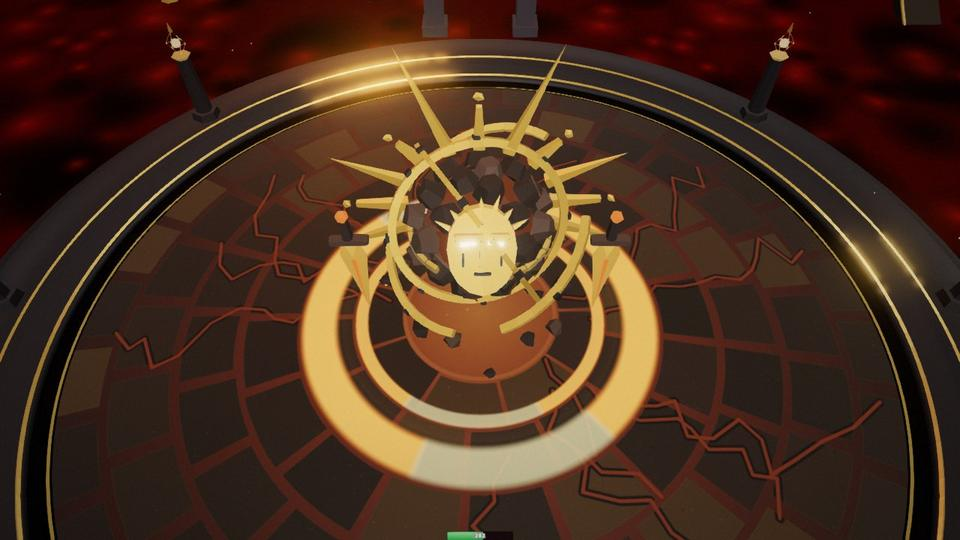
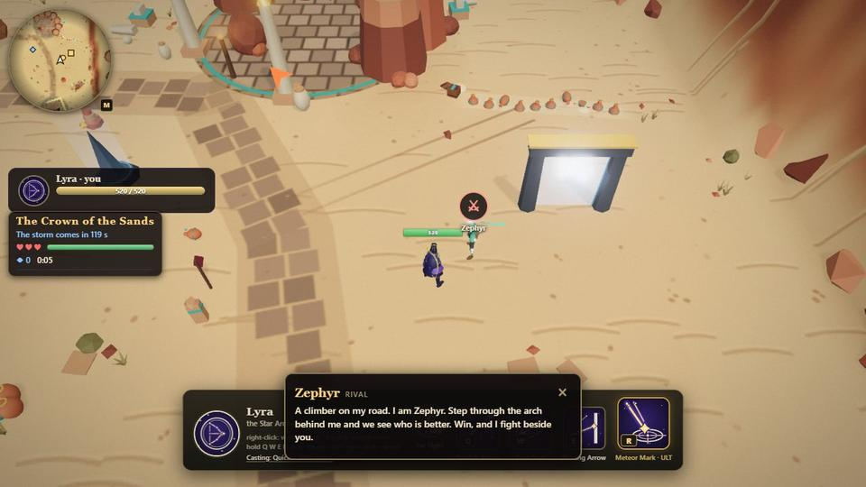
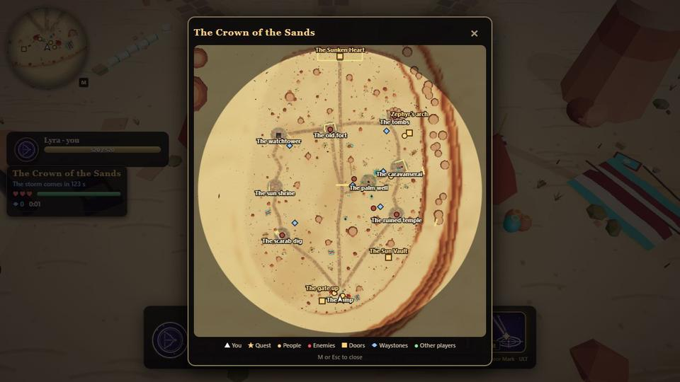
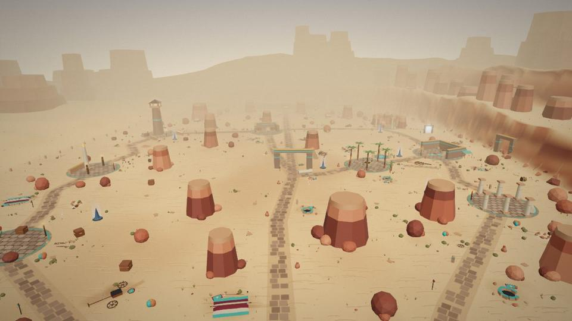

# Floor 30: The Crown of the Sands

Clean: the Sands' crown. Cleared with four stars and no fall, no console error, every spot reachable; the Heart of Noon (the Raid's boss, its own model, in the Sunken Heart) fell on the first try; the caravan, the rival (Zephyr), the trial and the gate (Bo) all played.

## Measured

- Reachable from the camp: 34013 m²; 55 spots of the floor's data, 0 cut off
- Props probe: 3 float, 3 gap, 20 buried, 2 in cover (each looked at; see below)
- Grass and small things on ground steeper than 31°: 0
- Packs table for the open world (server/climb-packs.mjs): matches
- Route bot (Lyra): cleared in 1840 game s, every checkpoint reached; 56 kills, 0 falls, stars 1111; ruler tries 1, gate tries 1; page errors 0
- Ruler: The Heart of Noon (The Fallen Sun), model models/bosses/heart.glb, loaded yes after 1851 ms of real time
- Frame check at the busiest spot (40, 23), 6 units awake: median 3.3, 3.6, 4.9 ms, p95 5.6, 8.3, 8.8 ms (desktop, machine shared: rough)
- Console errors while taking the pictures: 0

## Found

- **ok: Props.** The probe's “gap” is a gateway's lintel over its passage (meant); shrubs on the rim a few cm up; red rocks a little sunk.

## Not checked

- the shared packs online
- buying at the trader (card and prices shown)

## Pictures

  
The Sunken Heart as the fight opens

  
The Heart of Noon

  
Zephyr, the rival

  
The M map

  
From the south edge

