# Fixed after the review (2026-11-16)

Two items from the list "For you to decide" on this review's page, done after it. This folder is written by hand; the page's
"Fixed after" section links here (`climb-review-page.py` does not write it: copy the section back if the page is made again).

## Floor 1: the ruler is the Drowned Admiral

The floor called its ruler "the Drowned Captain"; the lore (the Codex, climb/rulers.md and climb/sea.md) says the Drowned Admiral
rules floors 1 and 2, and the model is the Admiral's. Renamed in the game's strings, not in the lore:

- the ruler's name and its first phase ("The Admiral wakes"): `src/tower/world/pieces/floors.ts`
- the keeper's greeting, the main quest's last words, the lair's door, the gate's locked line: `src/tower/world/gen/harbour.ts`,
  re-baked with `node pipeline/tools/gen-floors.ts harbour`. The bake changed only those four strings
  (`src/tower/world/floors/gen/harbour-big.ts`, 4 lines; the floor list unchanged).
- comments that named him (zone.ts, gen/sea.ts, pieces/rulerModels.ts) and the film tool's label (pipeline/tools/world-film.js).

Left for you: "The Captain's Key" (the quest's key, guarded by the Mate) keeps its name, and the keeper still says the Admiral sits
behind a chain "only the captain's key will lift". Whose captain that is now reads less clearly; rename the key (for example "The
Admiral's Key") or keep it?

Nothing keys off the name (motion styles, seeds, server, sims checked). The News page's older text and the lore's note
("once called the Drowned Captain in the floor's oldest code") are left as they are.

Checked in the game (desktop): the M map names "The Drowned Admiral's lair"; through the door the banner and the objective say
"The Drowned Admiral", with his own model.

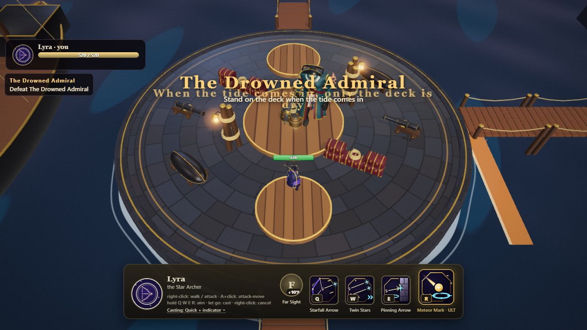
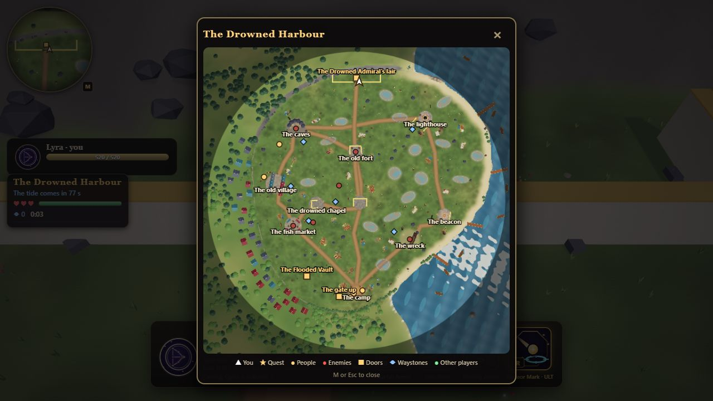

## Phone: the hero's plate fits what is in it, clear of the floor panel

The box with the hero's portrait and passive (the touch HUD's plate, built in `src/heroMode.ts`) kept an empty buff row under the
passive's name (14 px and a 4 px gap), so its frame ran 18 px below its contents, down to the floor's panel. For a hero with a resource
bar (Brannoc's Heat, Cantor's, Vesper's) the plate is taller still and ran 24 px over the panel.

Fixed on the Climb only, without touching heroMode.ts. While the Climb's panel shows (`src/tower/world/hud.ts` puts `world-hud-on` on
the page), the plate's buff row is hidden while it is empty, and the panel keeps 6 px under the plate when the plate is taller than
the room above the panel: its own top, and the minimap's rule (`src/tower/world/map.ts`) while the minimap shows. The plate's height
comes from hud.ts (a ResizeObserver on the plate, phones only). Inside a set piece the panel is hidden and the plate is as in any
duel. A desktop has no plate and is unchanged (the panel's place and the pictures' HUD are the same before and after).

| | plate (px, top + height) | floor panel top |
|---|---|---|
| Lyra, floors 1, 21, 41, before | 190 + 100 | 294 |
| Lyra, after | 190 + 82 | 294 |
| Brannoc, floor 21, before | 190 + 128 | 294 (24 px under the plate) |
| Brannoc, after | 190 + 110 | 306 |
| Brannoc, floor 21, the first moments (before the minimap shows), before | 78 + 128 | 182 (24 px under the plate) |
| Brannoc, the first moments, after | 78 + 110 | 194 |
| Desktop, floors 1, 21, 41 | no plate | 312, before and after |

A buff on the hero shows the row again (the plate grows by 18 px while it lasts; for a hero with a resource bar the panel steps
down with it).

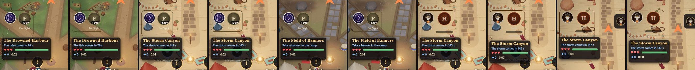

| | before | after |
|---|---|---|
| Phone, floor 1 | 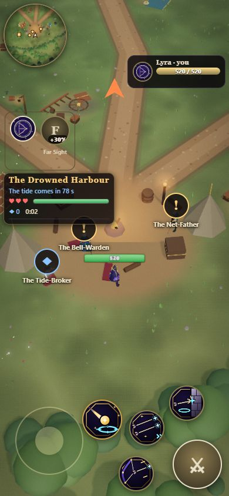 | 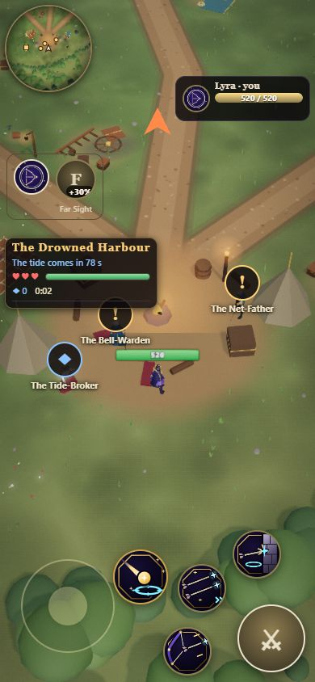 |
| Phone, floor 21 | 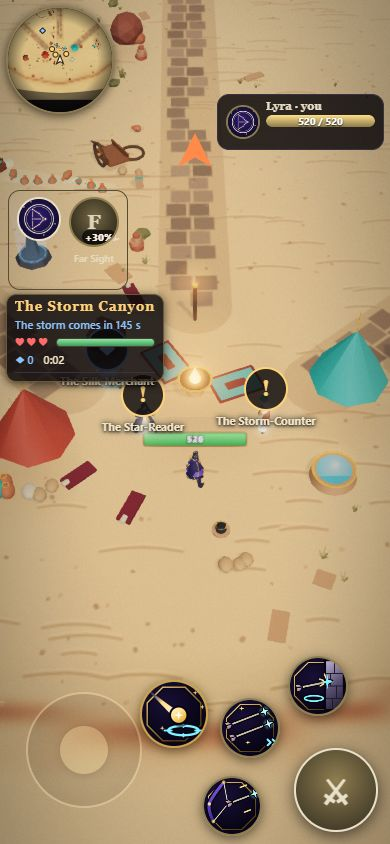 | 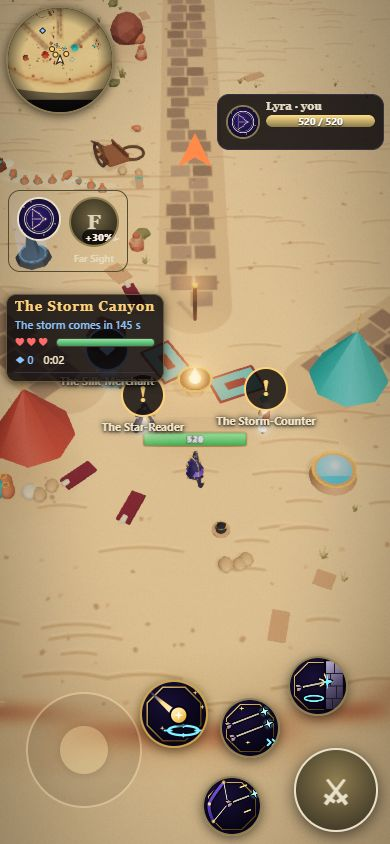 |
| Phone, floor 41 |  | 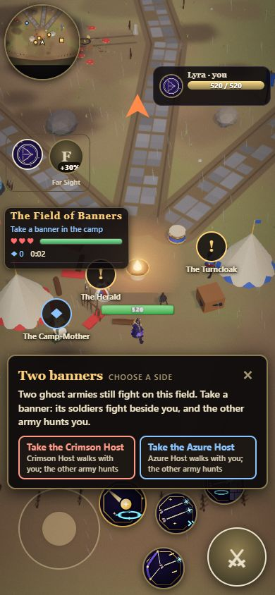 |
| Phone, floor 21, Brannoc | 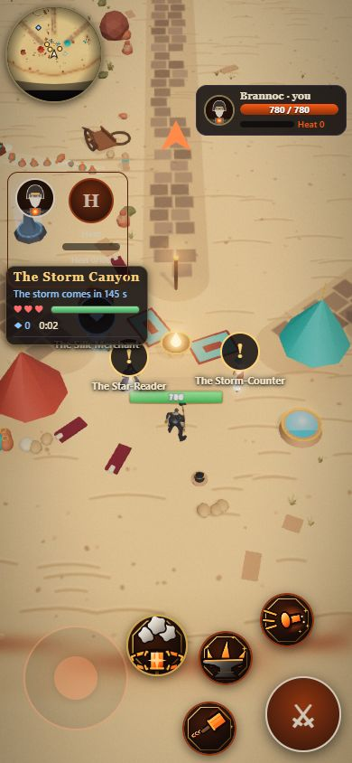 | 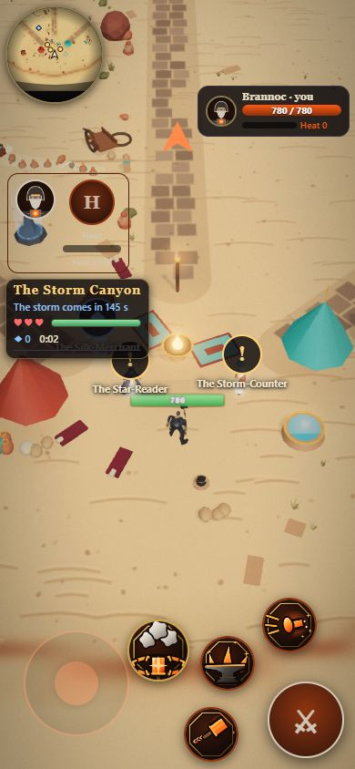 |
| Phone, floor 21, Brannoc, the first moments | 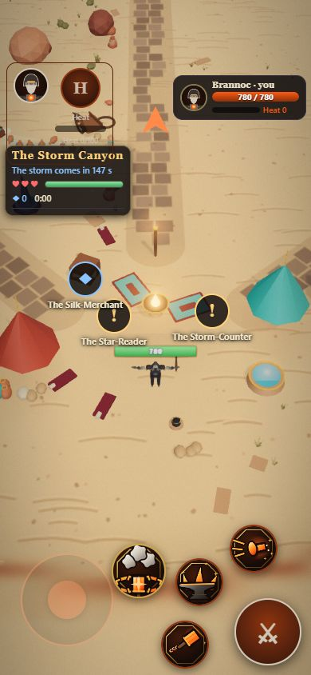 | 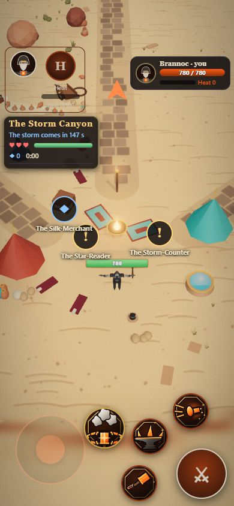 |
| Desktop, floor 1 | 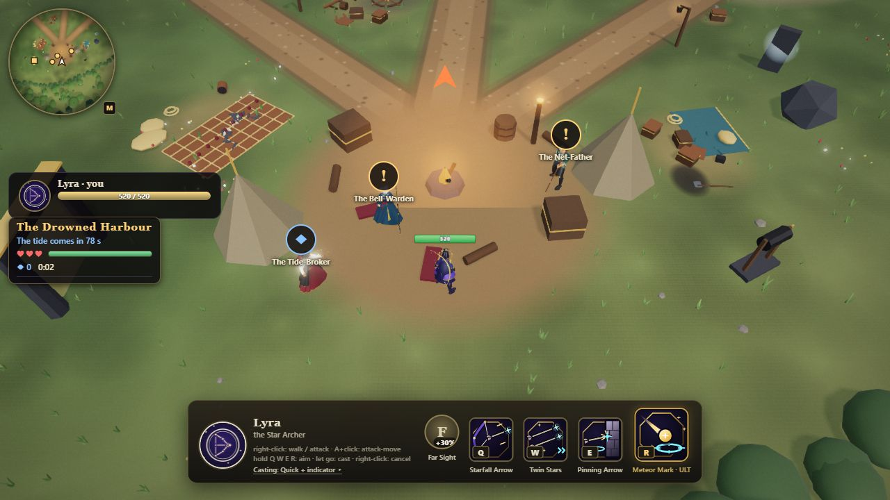 |  |
| Desktop, floor 21 | 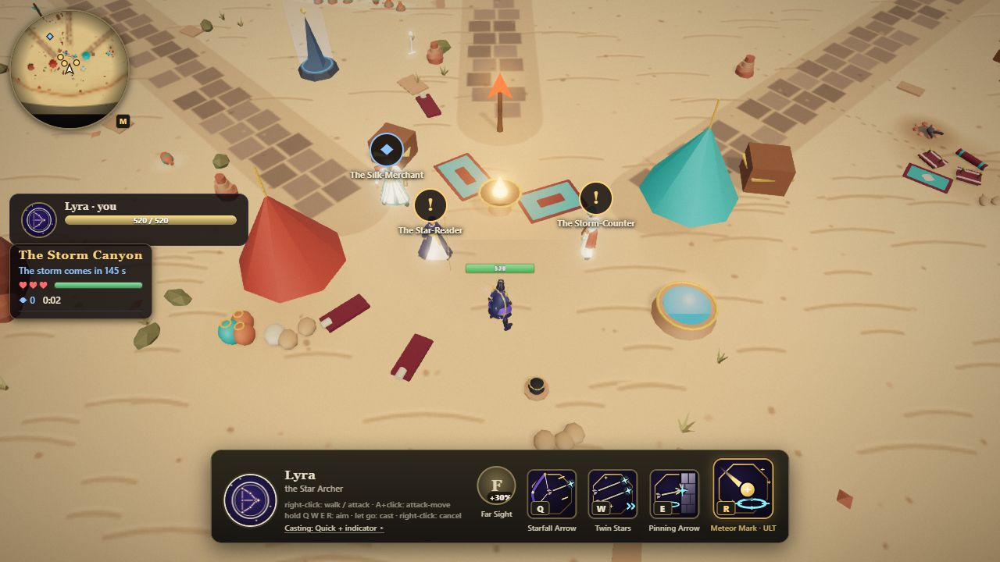 |  |
| Desktop, floor 41 | 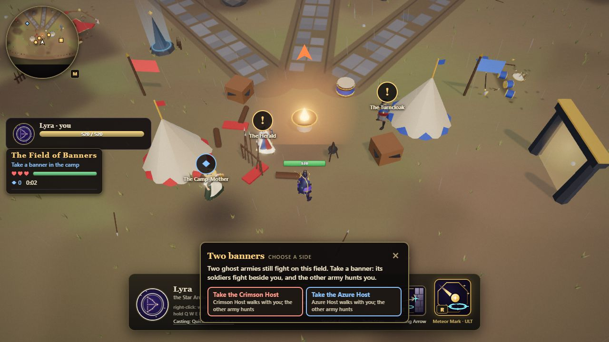 | 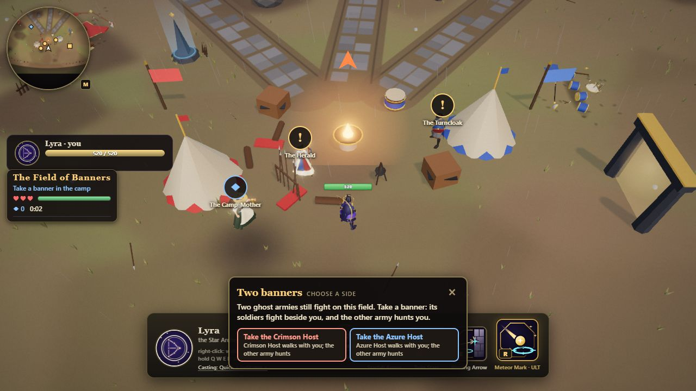 |

On a desktop the hero's bar and the floor panel touch by 3 px (bar 248 + 67, panel at 312), before and after: not changed here.
