# The Climb, floors 31 to 50: one floor at a time

2026-11-16. The user: "make agents that will go slowly through all tower floors and one by one check all things that are done and correct
them". This page is the second of the two agents: chapters IV (the Deep) and V (the War). Floors 1 to 30 are on their own page.

**How each floor was checked** (a dev server of its own, the game page in a hidden browser, time stepped by hand):
- **Played through** by the route bot (`_worldRoute`, pipeline/tools/world-tool.js) as Lyra: every quest taken, done and handed in, the race,
  every waystone, cache and the lore stone, the trial, the ruler and the gate; any error in the page is counted.
- **Walked on paper**: a flood fill of the floor from the camp (`_worldCheck`): every person, pack, quest spot, cache, door and stone must be
  reachable; and the busiest spot (most enemies within a pack's sight).
- **Props against the ground as drawn** (`climb-props-probe.js`): things in the air, light under one side, through cover, on walkable
  ground and the edge; and anything small standing on a cliff face (`climb-grass-probe.js`).
- **Looked at**: the camp, every person up close and their card, every pack standing and fighting, the doors and the lore stone, the big
  map (M), the ruler, the gatekeeper and the trial; the camp, the map and a card on a phone (390 x 844, touch).
- **Read**: every name and line of the floor against the lore (docs/lore/LORE.md and docs/lore/codex/, the Climb's chapters and The Long Noon).
- **Frames**: a rough frame time at the camp and in the busiest fight (the machine is shared with other agents: only clear outliers count).

## Fixed after (2026-11-16): the War's armies off the standards' stone feet

Floor 41's fault (round 2 of the model review: its places and its armies' homes in the middle of a standard's 0.9 m stone foot) was
in the War's generator, so floors 42 to 50 had it too. On each of them the two ridges and the works (the three standards the main
quest takes) stood their stand and the homes of both armies' packs there (a-r, a-b, c-r, c-b, e-r, e-b) at the standard's middle:
**9 spots a floor, 81 in all, each 0.9 m inside the cover.** Nothing else on these floors was in or on cover: every person, cache,
waystone, lore stone, door, patrol point and quest spot is more than 1 m clear (measured against every piece of cover with the new
`node pipeline/tools/climb-spots-probe.mjs 42-50`; floor 41 had none since its own fix).

- **The fix, as on floor 41**: in the generator (`makeWarFloor`, `src/tower/world/gen/war.ts`) each of the three stands and the
  two armies' homes there are 2.4 m from the standard's middle (1.5 m clear of the foot), on its outer side, between the standard and
  the shields or catapults behind it. Set after the dressing, and everything else is still laid out from the sites' middles, so the
  random draw does not change.
- **Re-baked from the same seeds** (`node pipeline/tools/gen-floors.ts 42-50`; 42000 to 50000, the first seed each, as before): in
  each `floors/gen/war-NN.ts` only those 9 points moved (18 lines, x and z only). The standards, the quest's "take the standard" steps,
  roads, waystones, people and everything else are where they were. The unchanged generator re-bakes the old files exactly (checked
  first). The hub's pack table re-written (`node pipeline/tools/climb-packs.mjs`; only the lines of 42 to 50 changed).
- **At home, before**: both armies' six soldiers stand pressed round the foot (the nearest 1.57 m from the standard's middle, at the
  foot's edge, the knights in the standard's pole). **After**: they stand between the standard and the shields or catapults, 1.4 to
  4.6 m from its middle; one or two of the six rest at the foot's edge, as on floor 41 after its fix (measured the same: 1.4 to 4.6 m).
- **Played through** by the route bot as Lyra, every floor cleared: no error in the page, no step left, nothing unreachable on paper
  (`_worldCheck`), at most 6 units near one spot. Four stars on 42, 43, 44, 46, 48, 50. On 45, 47 and 49 the "no fall" star was
  missed in some runs (45: in three of four, 47 and 49: in each): every fall whose place was logged (seven, in four runs) was a lost
  duel in the gate's own room (the gatekeeper at CPU level 3), where the floor's soldiers play no part; none on the field. (45's
  first run, one fall, did not log where.) 971 to 1163 s of game time.
- **The fights**: the perf prints on desktop, before and after on this worktree's own server (port 5187): world-5 (floor 41,
  not changed) the same fight, 216f3d58, before and after. gen-43 and gen-48 another fight (ff324ac2 -> 37ea4135,
  738e5fe2 -> 6fa7fa09), as expected: those scenes set the hero down beside each pack at its home, and the homes moved. The times
  were taken with other agents' jobs running (world-5, unchanged, went 14.9 -> 26.2 ms), so they show no difference either way.

Top row before, bottom row after; the three standards of each floor across (the game's camera direction, closer, the HUD hidden;
both armies switched on for the picture and asleep at home; in play neither is out before a banner is taken, and then only the
other army's is):

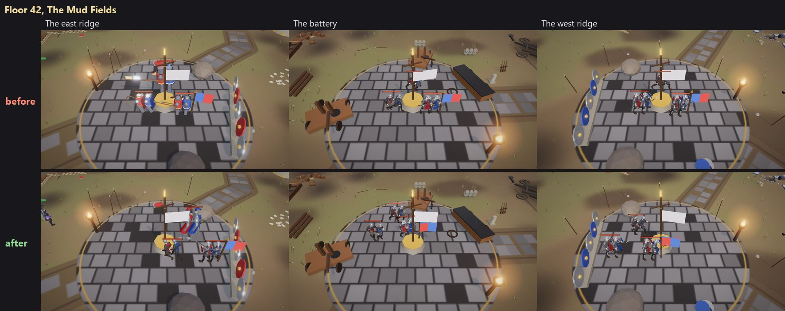

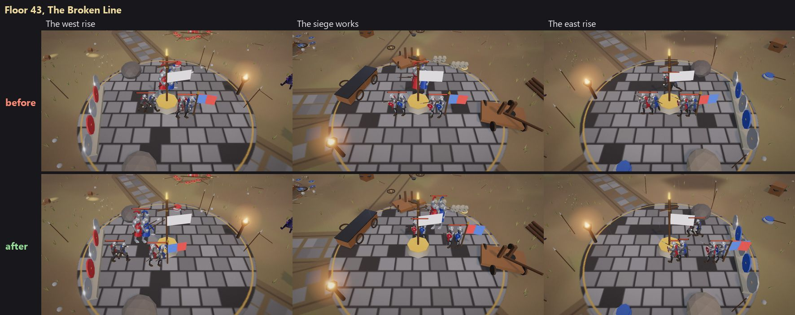

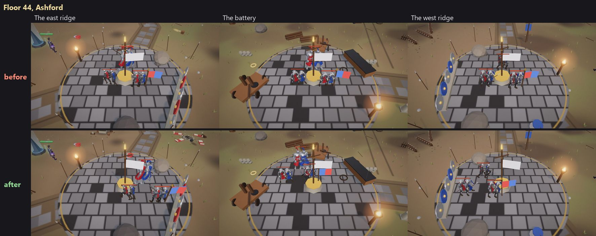

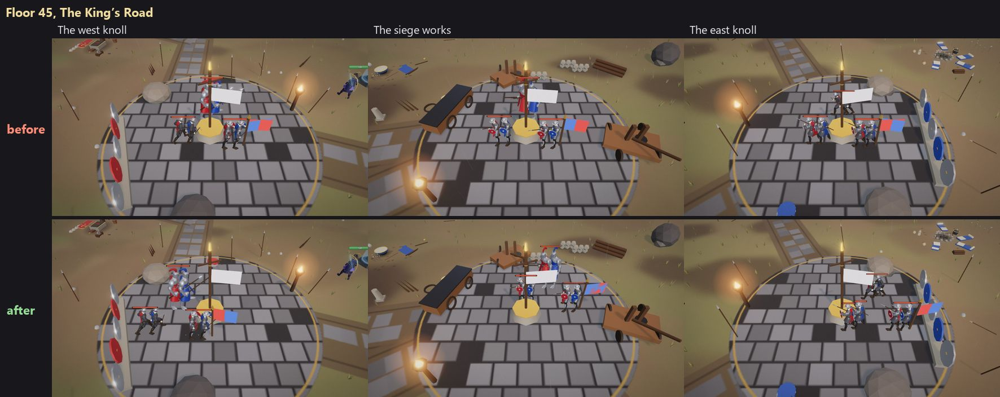

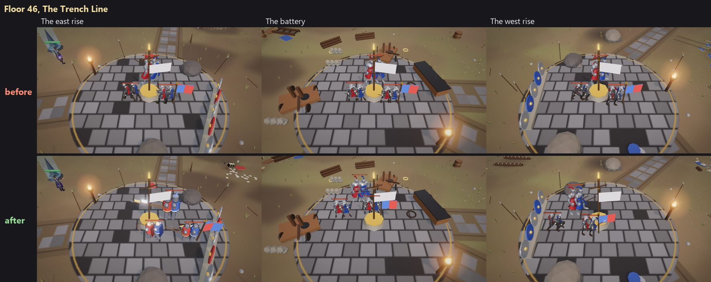

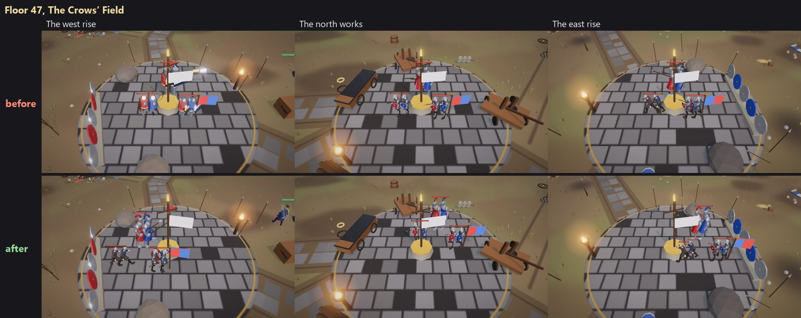

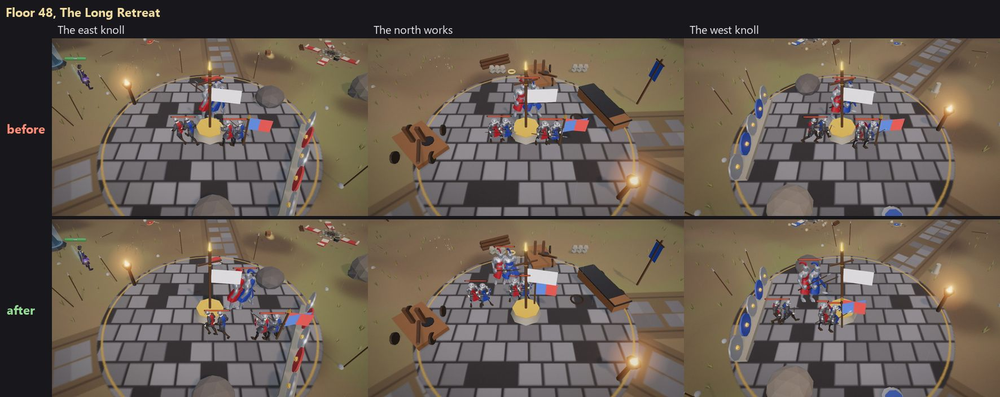

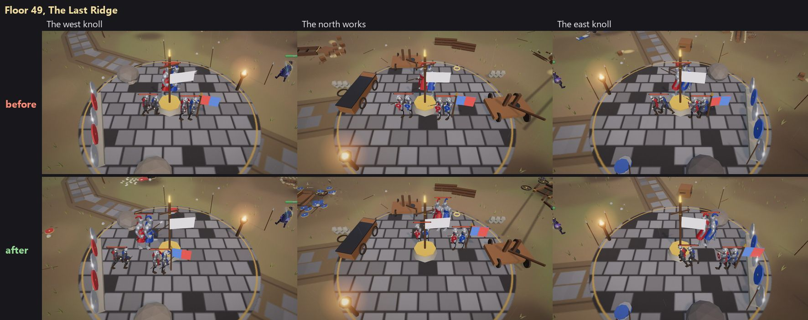

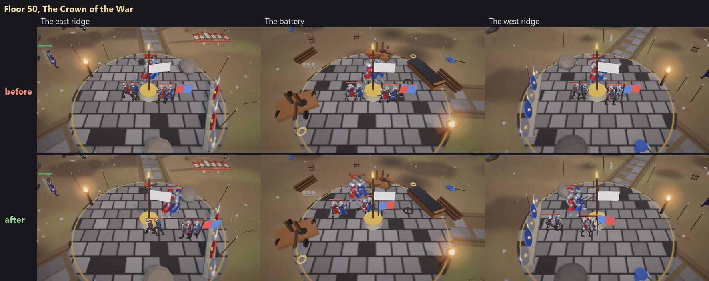

## The follow-up round (2026-11-16)

Eight items from the list, made after the round was merged (the list's own entries are below, under "Done in the follow-up round").
All chapters where the item is shared; the War's words in chapter V only.

- **People's marks under the HUD** (`src/tower/world/hud.ts`: the marks' layer 7 -> 5). They now pass under the floor's panel, the spell
  bar and the minimap, and stay over the world. A tap still lands on the mark itself, the hero walks over and the person's card opens
  (desktop and phone, floors 1, 34 and 41; a card already open, the law's or a trader's on the way, holds it, as before).
- **The set piece's title box under the hero's panel** (`src/tower/world/pieces/hud.ts`: 160 px down on a desktop, 172 px on a touch
  screen, under a phone's portrait and F key). Checked in a ruler, a gate and a trial on floors 1, 11, 21, 31 and 41, and the crowns of
  10 and 40, on both.
- **The trial rooms show the Climb's own floor** (I, XI, XXI, XXXI, XLI...): the room is still built and fought at the weekly height it
  was tuned at; only the number written on its floor changed (`label` in `src/tower/week.ts`, `src/tower/floors.ts`,
  `src/arenas/tower.ts`, `pieces/duels.ts`; a rival's duel room too).
- **A rival who is the hero you play is the next hero on the roster** (`src/tower/world/rival.ts`, used by `game.ts` and
  `pieces/index.ts`): its figure, its name in every line of the floor, its door, its duel and the boon it gives. Ids, places, packs
  and doors stay as they are. Floor 32 as Lyra: Vitriol waits in "Vitriol's gallery", says "I am Vitriol", fights on his own model;
  the route bot cleared the floor with four stars, the duel won. As Bram the floor is as it was (Lyra). A race rival swaps the same
  way (floor 31 as Tempo: Silvane runs).
- **The War's words** (chapter V; the baked floors and the generator, whose random draw is kept so a rebake stays the same): the Iron
  Marshal is "The crimson's iron hand"; the last phases are "The last charge" (42, 47), "The walls come down" (43), "Under no banner"
  (49); the Camp-Mother says her own "A cook feeds both armies, and both pay" on 43, 45, 47 and 49 (`folk.ts`).
- **A lost trial says "No life lost: the door stays open for one more try"** (was "Nothing lost", while health is not kept;
  `game.ts`).

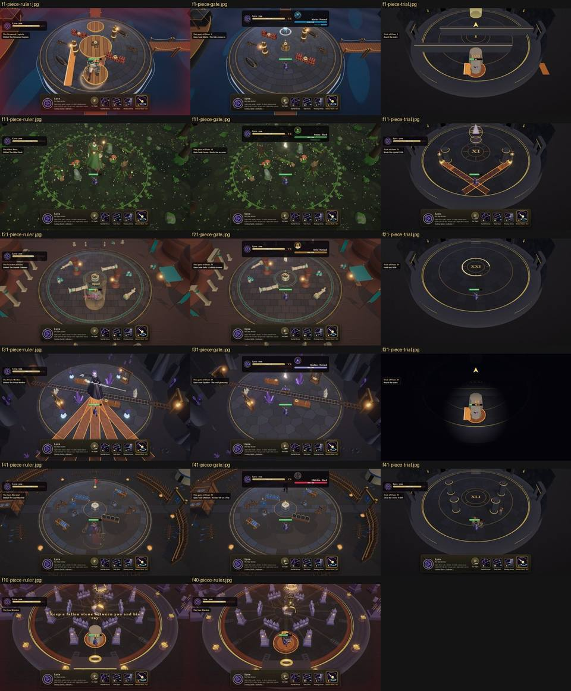
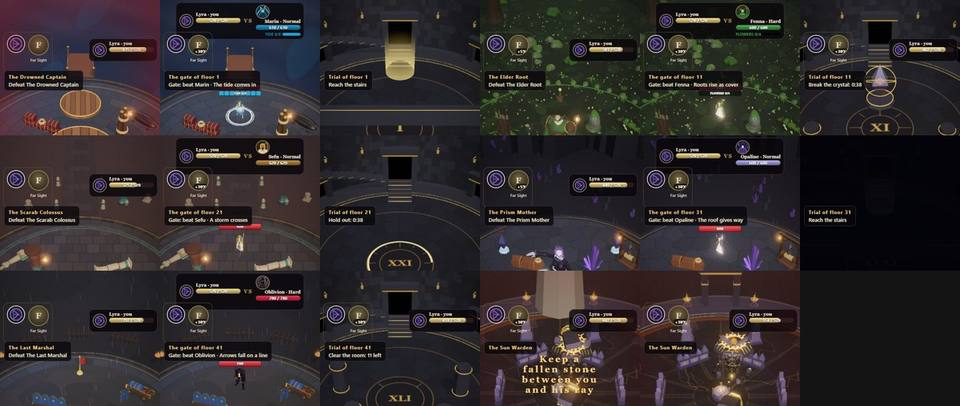
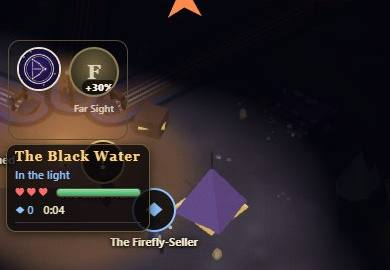
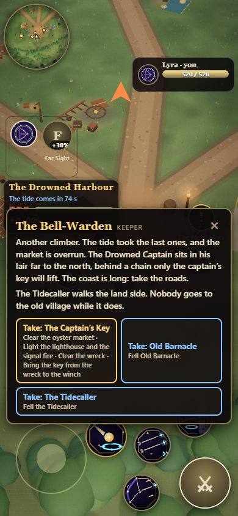
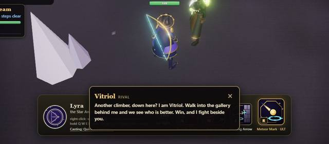
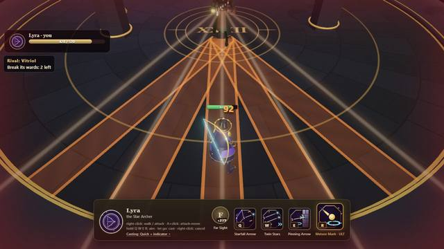

## The round in short

**20 floors checked, 31 to 50.** Every floor cleared by the route bot with no errors in the page; every spot of every floor
reachable; every person, pack, named enemy, ruler, gatekeeper and trial seen in the game with its own model; every name and line read
against the codex.

**Fixed (8 faults, at their cause, so every floor that shared them is set right):**
- The big map's names covered each other by the camps and ran off the map's edge (all floors; `map.ts`). Floor 31.
- People's "!" marks and names were drawn over the minimap (all floors; `map.ts`). Floor 32.
- Floor 31's Candle-Crowned still said Isolde's "cold woman" line under her crown of candles (`folk.ts`). Floor 31.
- A jetty ran through a stone ridge on its way to the water (floor 32; `deepDepth.ts`). Floor 32.
- The small crystal of each glowing cluster on the cave walls hung beside the wall, up to 2 m (all ten Deep floors; `deepZone.ts`).
  Floor 35.
- Brannoc, who hosts floor 41's duel, was marked as a quest giver with nothing to give ("…" over him, "Quests" on his card). Floor 41.
- "Ash and Ember waits / is / has fallen / wakes" on the last floor: they are two. Floor 50.
- The Turncloak stood in the camp's log bench (42) and against the tent (43): moved 1.2 m toward the fire on all nine made War floors
  (found by the model review). Floors 42 and 43.

**For you** (below): things in other agents' files this round, bigger changes, and matters of taste, each with where it shows and the
exact change I would make.

**Not changed:** hero numbers, kits, layouts, packs, the look's direction. The bot lost the gate to Oblivion (41) eight times in one run and
none in the next, and to Mum (49) eight times before winning: balance, noted only.

**Shared files touched** (each change tiny and checked on the other chapters): `src/tower/world/map.ts` (the map's names: checked on
floors 1, 11, 21, 41, desktop and phone; the minimap's layer), `src/tower/world/folk.ts` (floor 31's own line, as floors 11, 21, 41 have).

## Checked across the floors

**The War's two armies, floors 42 to 50.** Until a banner is taken both armies stay off the field (by design; the route bot never takes
one, so its runs fought only the ashen soldiers and the named). Taken by hand on each floor, Crimson and Azure in turn: four of the
hero's colour march beside it and the other colour's pack wakes and fights, footmen, bowmen and knights, on all nine floors.

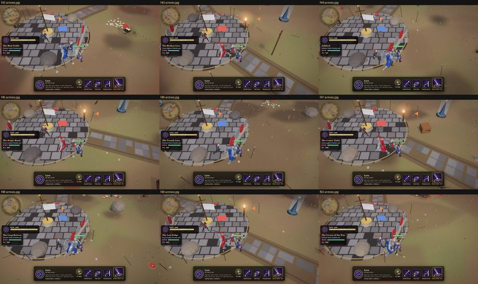

**The fights on a phone** (floors 31, 40, 41, 50): the ruler, the gate duel and a trader's card. They play and read; the set piece's
title box sits over the hero's portrait and F key (it lets taps through: only hidden, not blocked; in the list).

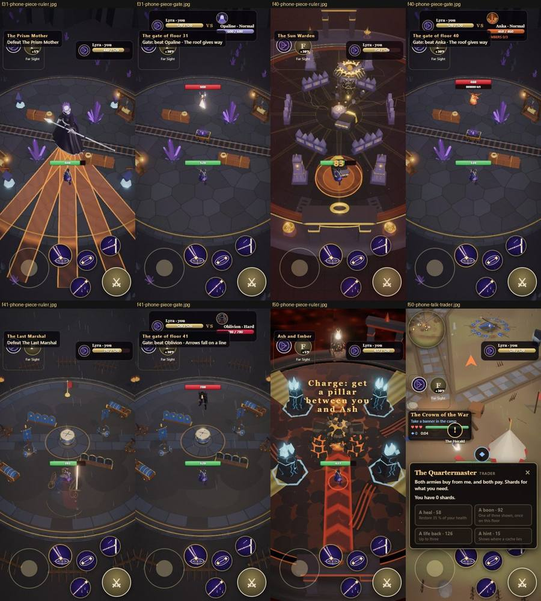

**The War's rulers up close** (41, 43, 46): each on its own model (the Last Marshal, the Siege Lord, the Crow King).

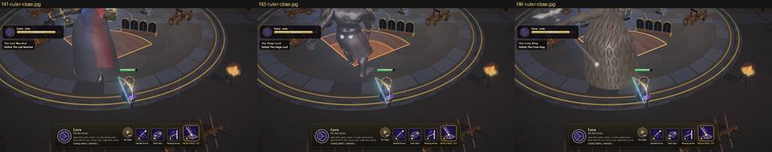

**The two fixes I could not make, tried live in the page** (no file changed): the people's marks on layer 5 go under the floor's panel
and the spell bar and can still be tapped (the keeper's card opens); the title box moved down clears the hero's portrait on a phone
(172 px) and the hero's panel on a desktop (160 px).

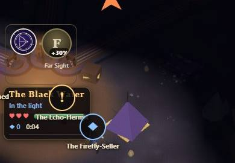
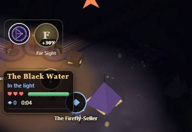
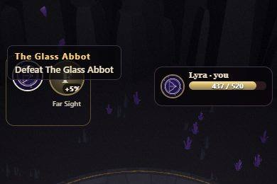
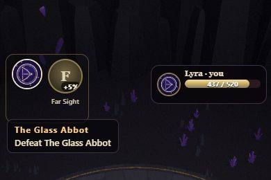
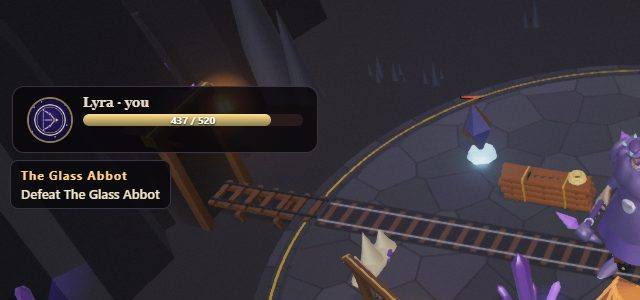

**Not seen as a fault:** on a fresh page the hero is not drawn for its first seconds on a floor (only its health bar) while its model
loads; it then stands posed. The T-poses in some tool pictures come from the tools stepping time by hand.

## Not checked in this round
- Packs shared between two players and their respawn (needs two signed-in players; stage 2 was tested in its own round).
- The perf tool's fixed prints and phone timings on a quiet machine (floors 21 and 41 are in STATUS); the frame times here are rough.
- Every hero: the route bot played Lyra only (balance per hero is the simulator's).
- Sound.

## Housekeeping
- My first tool runs made two empty folders, `C:\x` and `C:\x2` (a mistyped picture folder). Removing them was refused by the shell's
  safety check; they are empty and safe to delete by hand. A misplaced picture folder under `C:\Users\erich\.t3\AppData` (my own
  pictures only) was moved to the scratch folder and removed.
