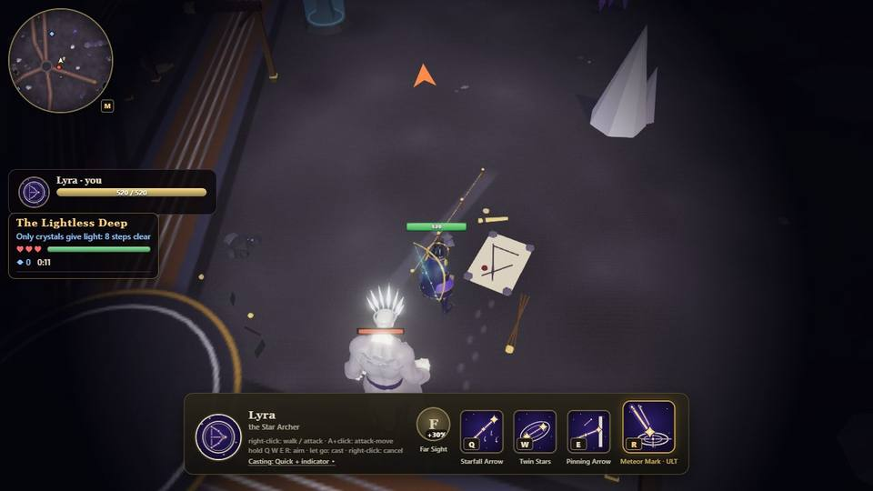
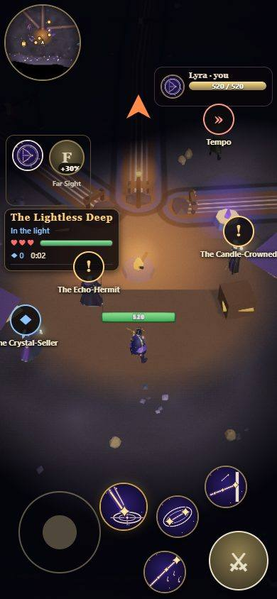
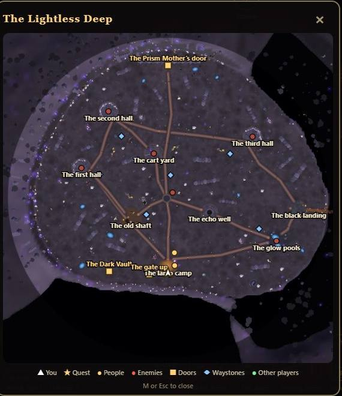
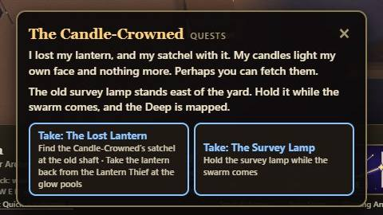

## Floor 31 · The Lightless Deep (Chapter IV opens)

**Played through:** cleared with four stars in 905 s of game time, no lives lost, no errors. All four quests (the Three Crystals, the
Pale One, the Lost Lantern, the Survey Lamp), the race with Tempo, six waystones, six caches, the lore stone, the Dark Vault, the Prism
Mother and Opaline at the gate: every one done. **Reachable:** all 43 spots of the floor. **Props:** nothing new in the air or through
cover on walkable ground (the gold keystone 20 m up and the stalactites were looked at in the props pass and left). **Frames:** about 7 ms at
the camp, 9 ms in the busiest fight (five enemies), one spike as the packs woke.

### Fixed
- **The big map's names covered each other** (all floors): by the camp, "The Dark Vault", "The gate up" and "The lamp camp" were written
  over each other, and on a phone "The black landing" ran off the map's edge. A name now steps a line down or up when it would cover one
  already written, and stays inside the map (`src/tower/world/map.ts`, the shared map: only where names are written changed).

- **The Candle-Crowned's greeting** was still Isolde's: "Without light I am only a cold woman in a cave", said under a crown of burning
  candles. Now: "I lost my lantern, and my satchel with it. My candles light my own face and nothing more. Perhaps you can fetch them."
  (`src/tower/world/folk.ts`, floor 31's own line, the way floors 11, 21 and 41 already have theirs.)

### Left (in the list for the user)
- The trial room (the Dark Vault) has "VIII" carved on its far wall: the old weekly Tower's height its fight was tuned at, not the
  floor's number. The title says "Trial of floor 31". The room is the set pieces' code (not mine to change in this round).

