## Floor 32 · The Amethyst Seam

**Played through:** cleared with four stars in 1247 s of game time, no lives lost, nothing stuck, no errors: the Three Crystals (three
halls cleared, three shards carried, three crystals woken, the rock fall), the Hollow Foreman and Old Pick, the Lost Lantern, the Survey
Lamp, Bring Tobin Up, the duel in Lyra's gallery, six waystones, six caches, the lore stone, the Ore Cellar, the Hollow Queen and Pip at
the gate. **Reachable:** all 53 spots. **Read:** the names and lines fit the Deep's chapter; the ruler is the codex's Hollow Queen (on the
Prism Mother's model in her own tint, as the rulers' round decided: three models a chapter). **Frames:** about 6 ms at the camp, 9 ms in
the busiest fight.

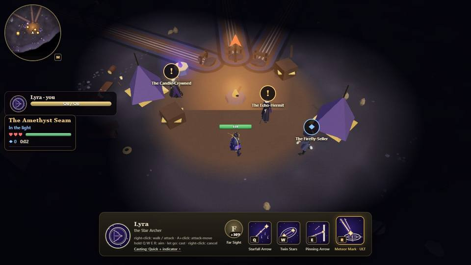
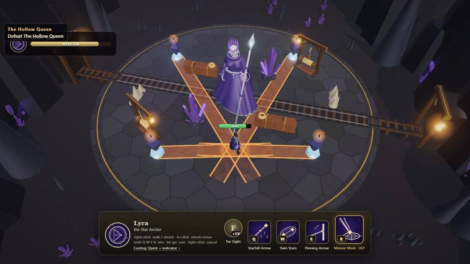
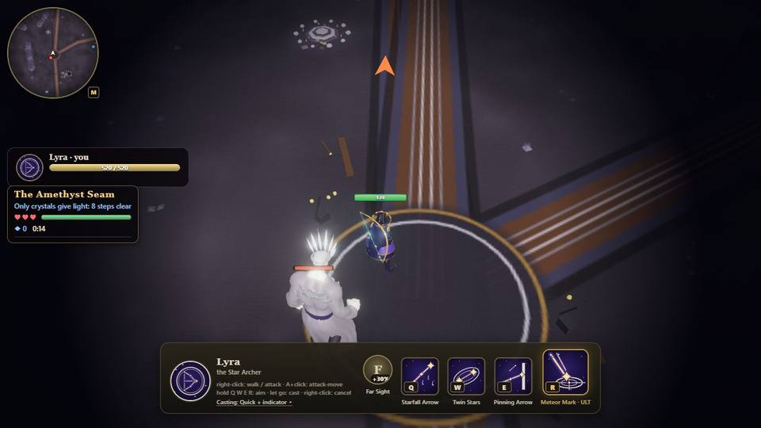
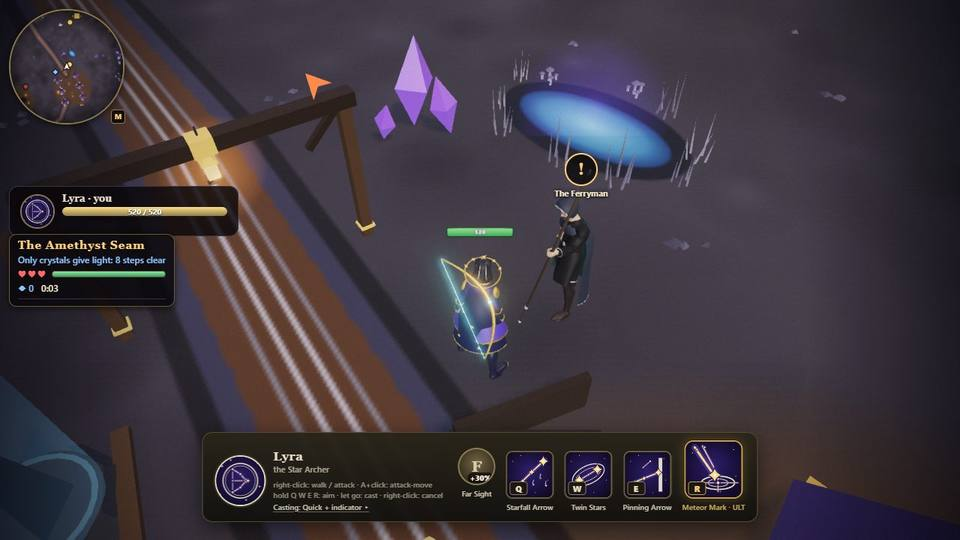
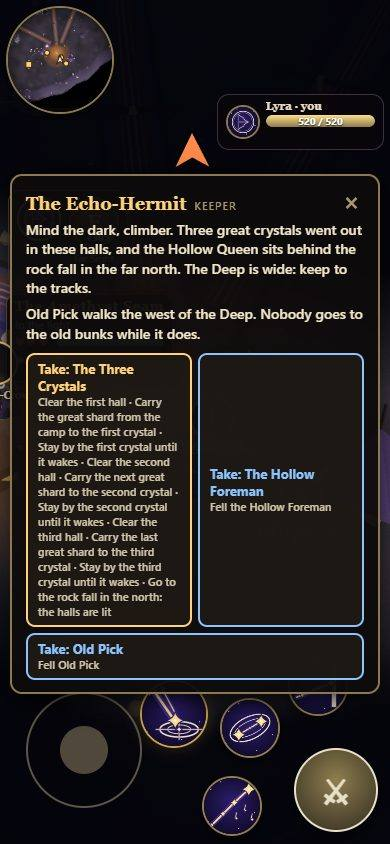

### Fixed
- **A jetty ran through a stone ridge** (the still shore, west): from the landing it crossed dry ground, went through a ridge of rock and
  only then reached the black water. A jetty now starts past the last rock on its line, so here it begins at the shore and runs out over
  the water (`src/tower/world/deepDepth.ts`; the rock test now sees the ridges too). Checked on all ten Deep floors: only floor 32's
  jetty moves; nothing on the game's random stream changes. The props probe's "through cover" on this floor: 5 -> 0.

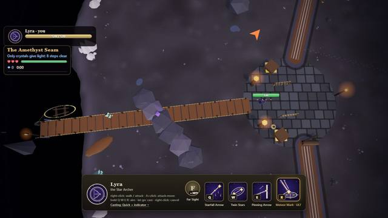
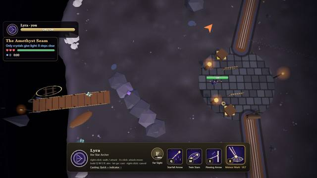
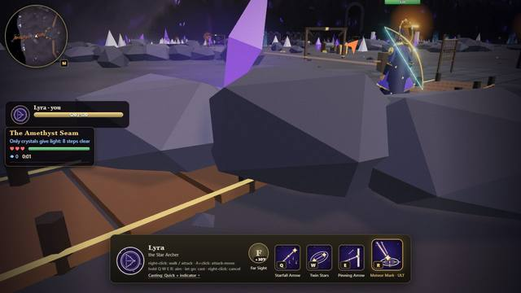
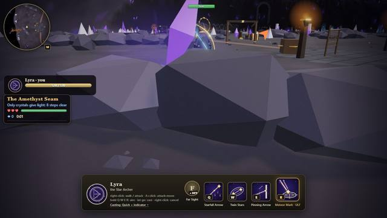

- **People's marks showed over the minimap** (all floors): a person standing at the top-left of the screen had its "!" and name drawn
  over the minimap. The minimap now lies over the world's marks (and still under the cards, the banner and the big map;
  `src/tower/world/map.ts`).

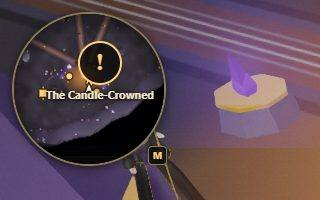
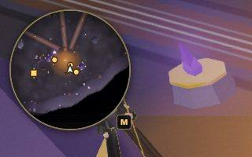

### Left (in the list for the user)
- The rival is a hero, and it can be the hero you play: the bot played Lyra and met "I am Lyra" in Lyra's gallery (every floor with a
  rival can do this, in all chapters).

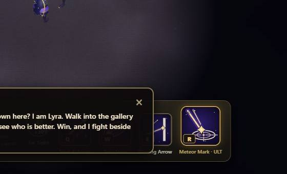
