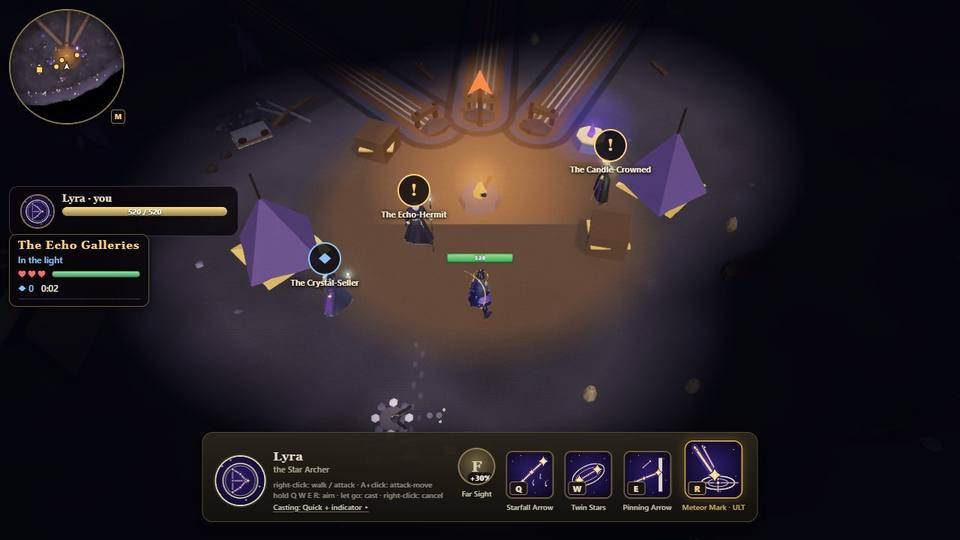
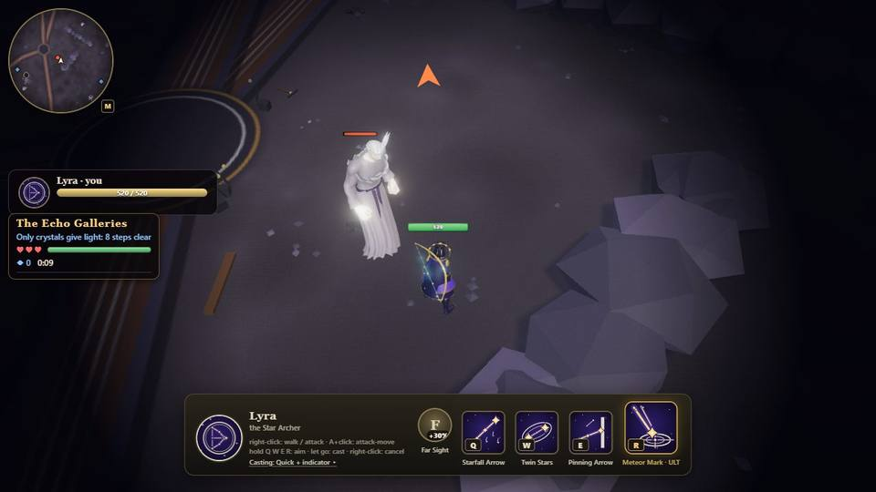
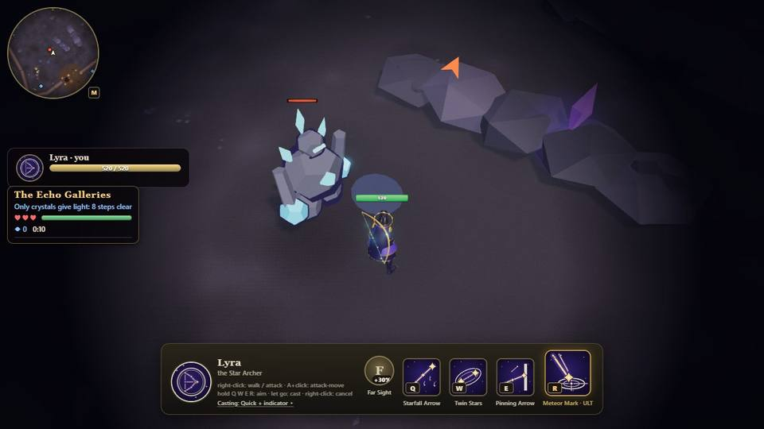
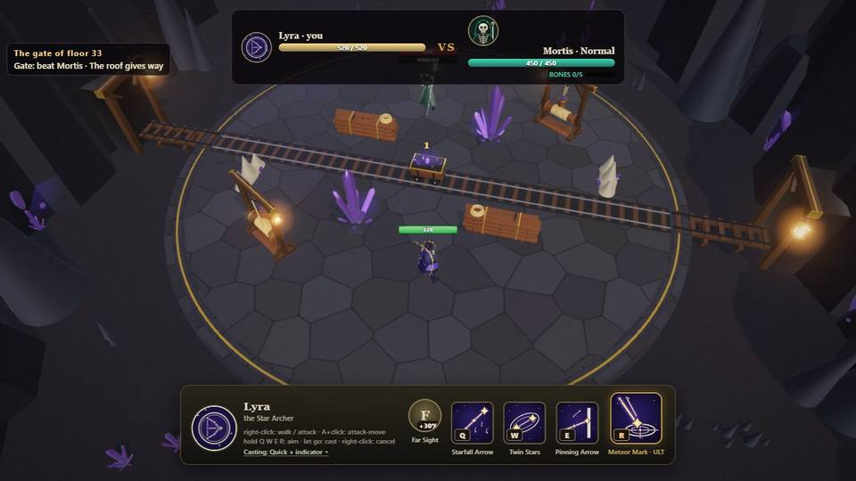
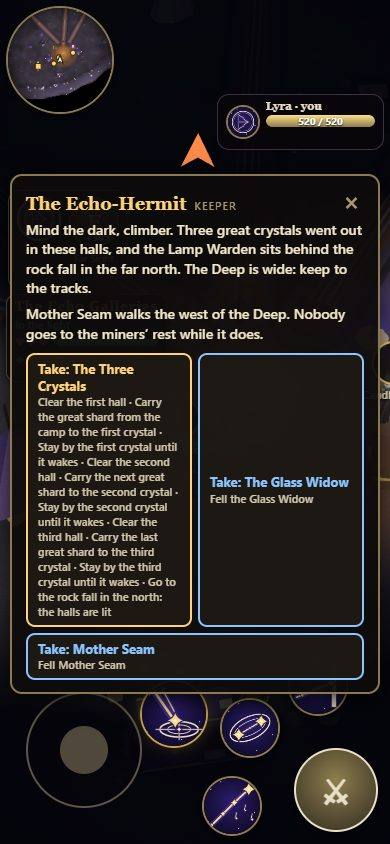

## Floor 33 · The Echo Galleries

**Played through:** cleared with four stars in 1165 s of game time, no lives lost, nothing stuck, no errors (every quest, Bram's
gallery, six waystones, six caches, the lore stone, the Dark Vault, the Lamp Warden, Mortis at the gate). **Reachable:** all spots.
**Read:** the names and lines fit; the ruler is the codex's Lamp Warden, on the lamp model. **Props:** nothing in the air or through
cover on walkable ground. Six violet crystals at the cave's foot stand 0.1 to 1.1 m off the slope behind them; looked at from the
game's camera they are not seen (left). **Frames:** about 3.5 ms at the camp and in the busiest fight. **Phone:** usable.

### Fixed
- Nothing on this floor of its own (the map's names and the minimap from floors 31 and 32 apply here too).
