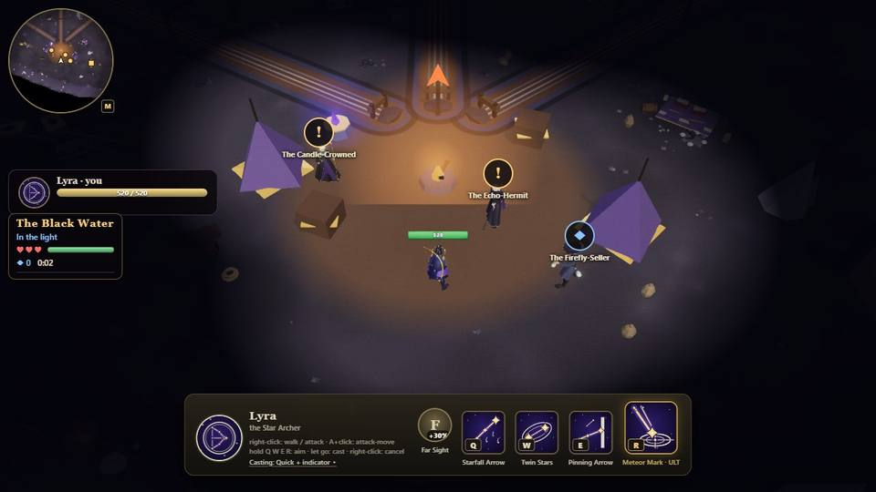
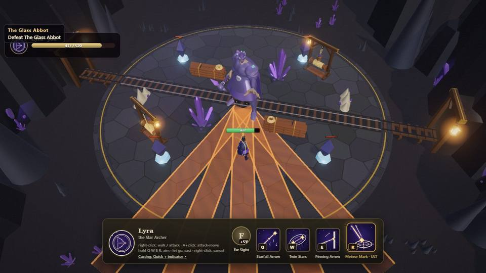
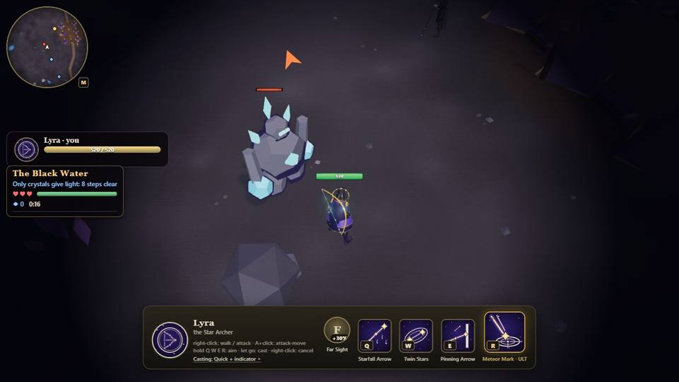
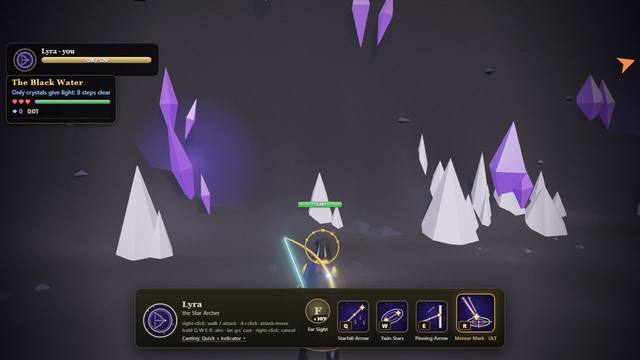
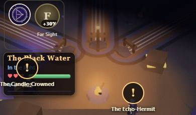

## Floor 34 · The Black Water

**Played through:** cleared with four stars in 1232 s of game time, no lives lost, nothing stuck, no errors (the Sleeping Halls, the
Lampless and Grey Tallow, the Lost Lantern, the Survey Lamp, Bring Sorrel Up, Marin's gallery, every waystone, cache and the lore stone,
the Dark Vault, the Glass Abbot, Cantor at the gate). **Reachable:** all spots. **Read:** the names and lines fit; the ruler is the
codex's Glass Abbot, on the seam model. **Frames:** about 9 ms at the camp and in the busiest fight.

### Looked at, left
- **Crystals in the north wall's arch** (the opening onto a second cavern, every Deep floor): its violet crystals stand on the opening's
  sill, 0.9 to 1.7 m over the cave floor in front of it; from a camera set low they seem to hang in the dark. From the game's camera they
  read as part of the arch.

### Left (in the list for the user)
- **On a phone, a person's mark lies over the floor's panel** (the Candle-Crowned's "!" and name over "The Black Water / In the light").
  The marks and the panel are both the HUD's (`src/tower/world/hud.ts`, not mine to change in this round): the fix is the panel's layer
  6 -> 8, as the minimap got on floor 32.

