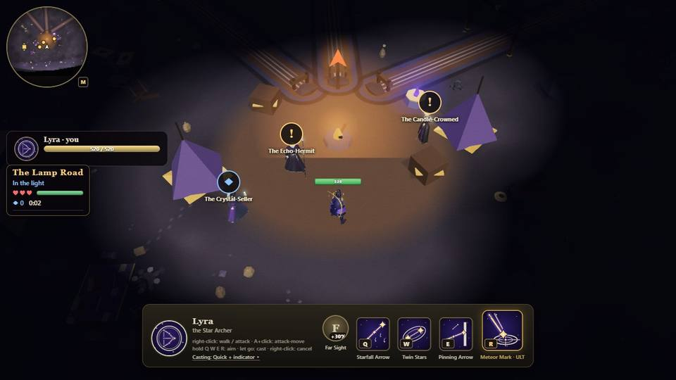
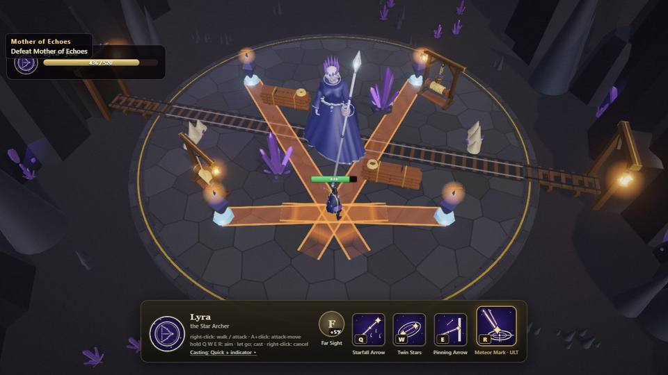
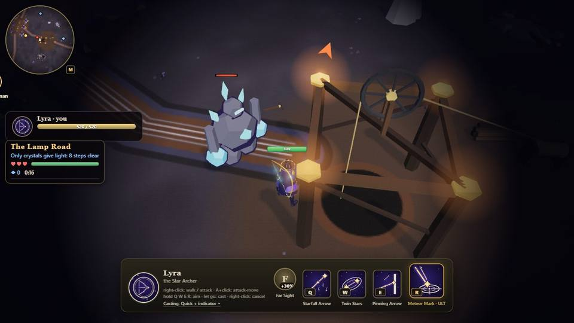
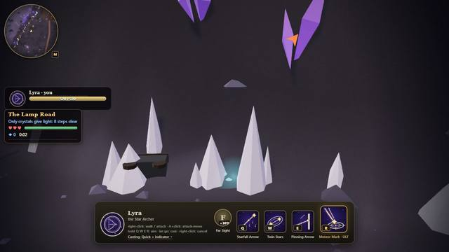
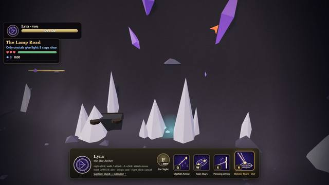

## Floor 35 · The Lamp Road

**Played through:** cleared with four stars in 1280 s of game time, no lives lost, nothing stuck, no errors (the Three Crystals, the
Stone Choir and Cinder Jack, the Lost Lantern, the Survey Lamp, Bring Abel Up, Nyx's gallery, every waystone, cache and the lore
stone, the Dark Vault, Mother of Echoes, Hank at the gate). **Reachable:** all spots. **Read:** the names and lines fit; the ruler is
the codex's Mother of Echoes. **Frames:** about 8 ms at the camp, 11 ms in the busiest fight (one slow frame of 97 ms at the camp as the
floor's shaders came in).

### Fixed
- **Crystals hanging off the cave walls** (every Deep floor, 31 to 40): each cluster of glowing crystals on the walls is a big crystal
  and a small one 0.7 m beside it, and the small one was set at the big one's height; where the wall is steep it hung in the air, up to
  2 m (here three of them by the walkable edge in the west). The small one now stands on its own ground
  (`src/tower/world/deepZone.ts`, no new random draws: nothing else moves). The probe's things in the air on the Deep's floors:
  31: 250 -> 234, 32: 233 -> 230, 33: 242 -> 229, 34: 247 -> 241, 35: 253 -> 240; those by the walkable edge on floor 35: 6 -> 2 (the
  arch's keystone 20 m up and one chip). What is left in the air past the edge is the stalactites (by design) and the arch's crystals
  (floor 34).

