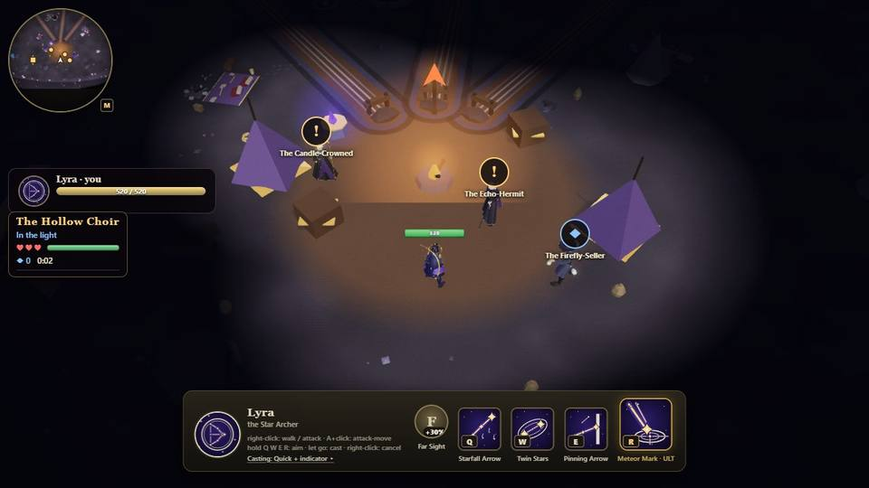
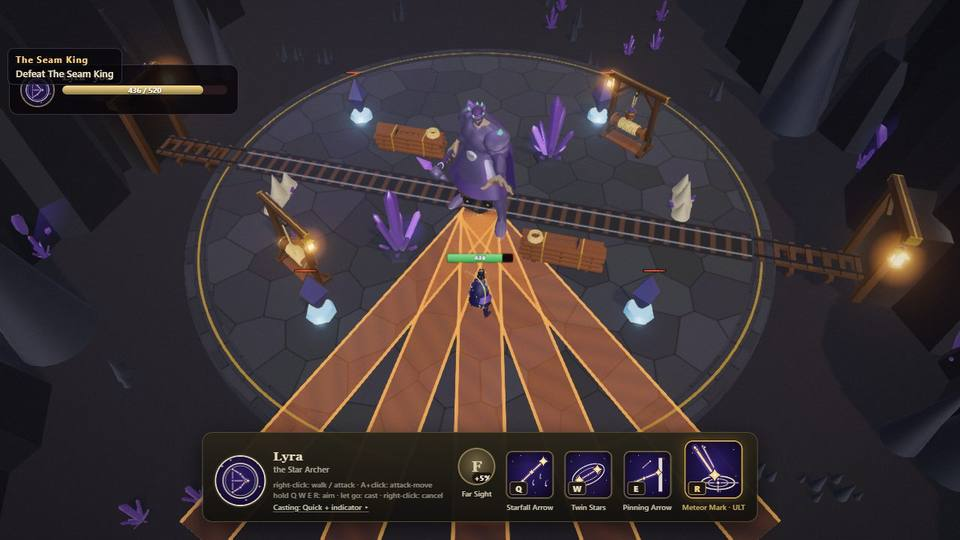
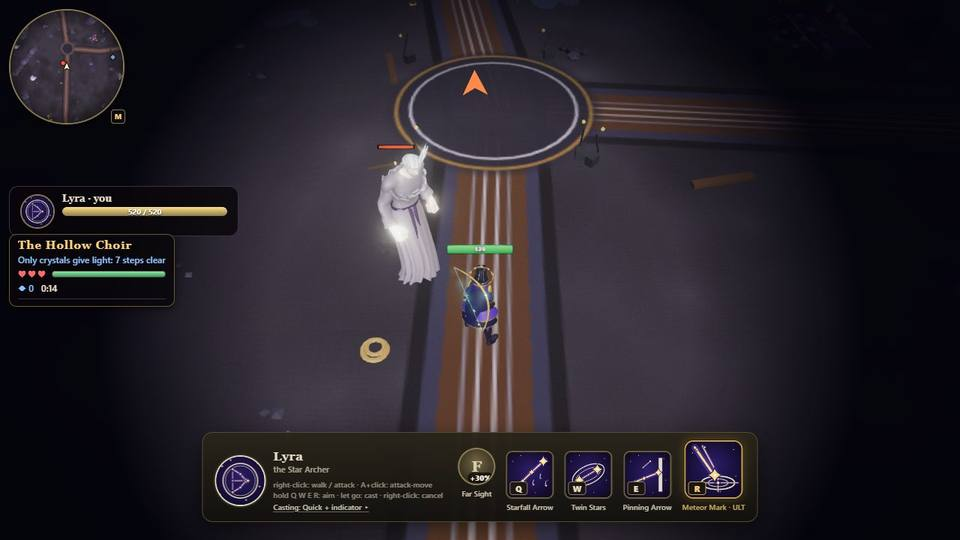
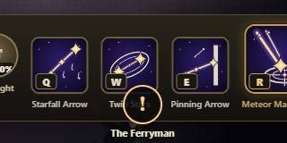

## Floor 36 · The Hollow Choir

**Played through:** cleared with four stars in 1478 s of game time, no lives lost, nothing stuck, no errors (Light the Deep, the Long
Dark and Quartz Annie, the Lost Lantern, the Survey Lamp, Bring Abel Up, Wick's gallery, every waystone, cache and the lore stone, the
Dark Vault, the Seam King, Gus at the gate). **Reachable:** all spots. **Read:** the names and lines fit; the ruler is the codex's Seam
King, on the seam model; from here the dark is a step tighter ("7 steps clear"), as written. **Frames:** about 8 ms at the camp, 9 ms
in the busiest fight.

### Small, left
- The man to bring up from the shaft is called Abel on floor 35 and on floor 36 too (the generator's name list; the floors are baked,
  and the name is in the quest's step, so I left it).

### Left (in the list for the user)
- A person's mark over the spell bar (the Ferryman's "!" over the W key): the same as floor 34's mark over the floor's panel.

