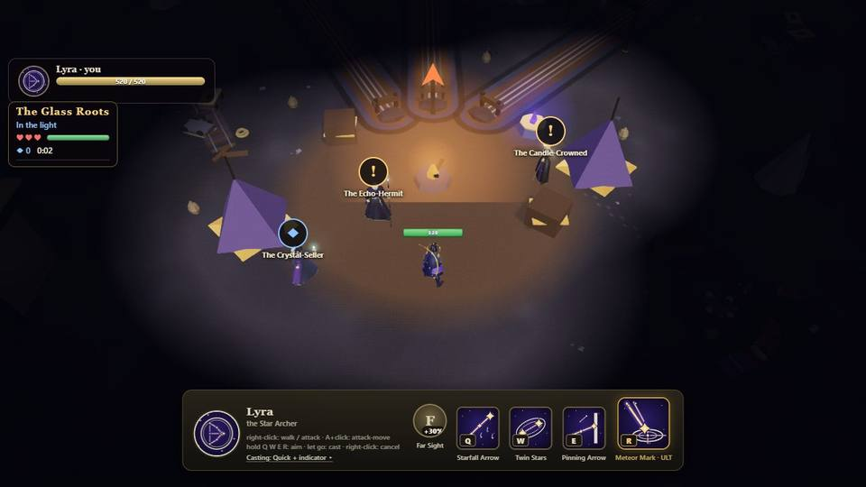
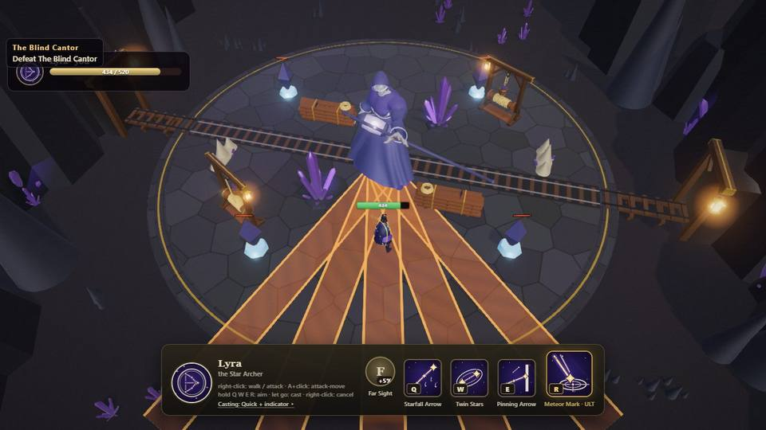
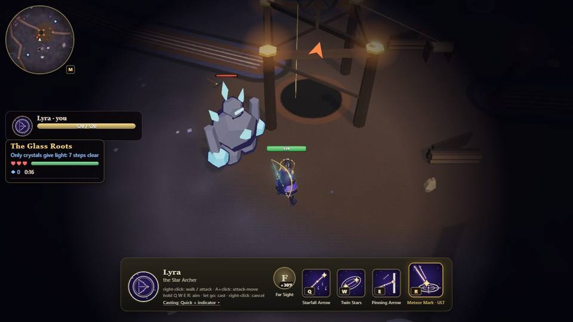
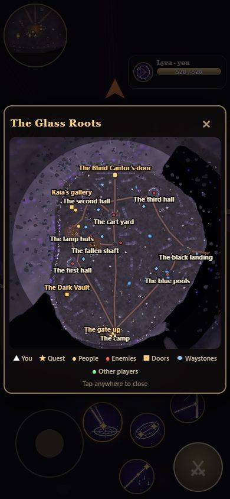

## Floor 37 · The Glass Roots

**Played through:** cleared with four stars in 1340 s of game time, no lives lost, nothing stuck, no errors (Light the Deep, the Last
Shift and Brother Flint, the Lost Lantern, the Survey Lamp, Bring Tobin Up, Kaia's gallery, every waystone, cache and the lore stone,
the Dark Vault, the Blind Cantor, Vitriol at the gate). **Reachable:** all spots. **Read:** the names and lines fit; the ruler is the
codex's Blind Cantor (one of the hundred of the choir), on the lamp model. **Props:** nothing in the air or through cover on walkable
ground (the arch's keystone aside). **Frames:** about 7 ms at the camp, 8 ms in the busiest fight. **Phone:** usable.

### Fixed
- Nothing of its own.
