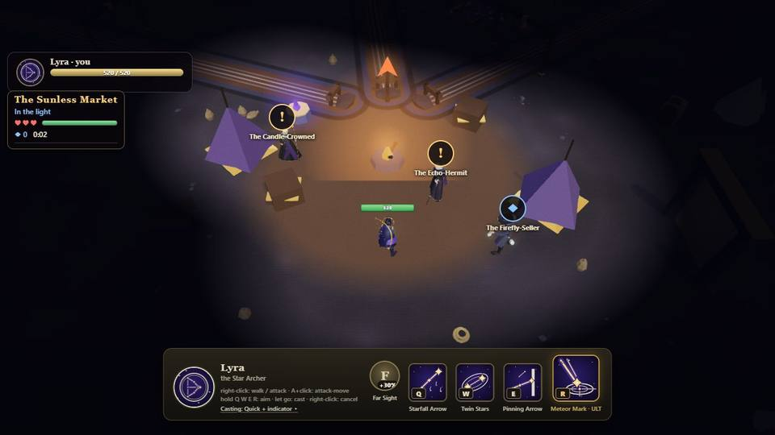
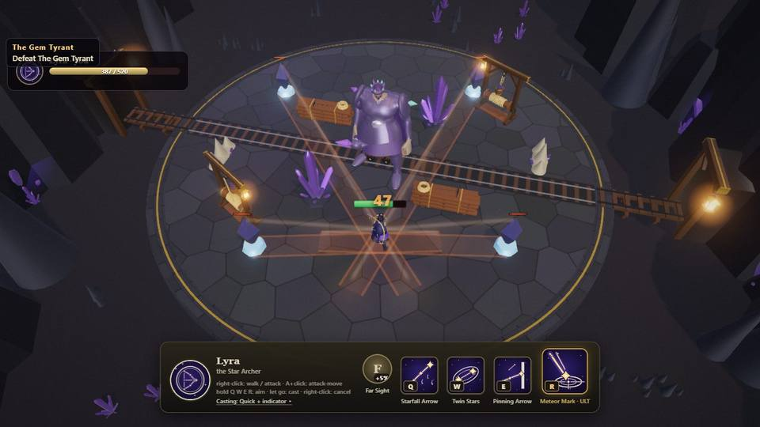
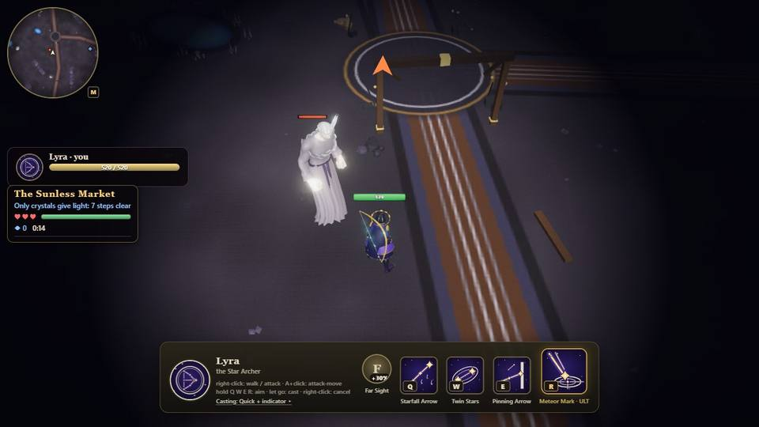
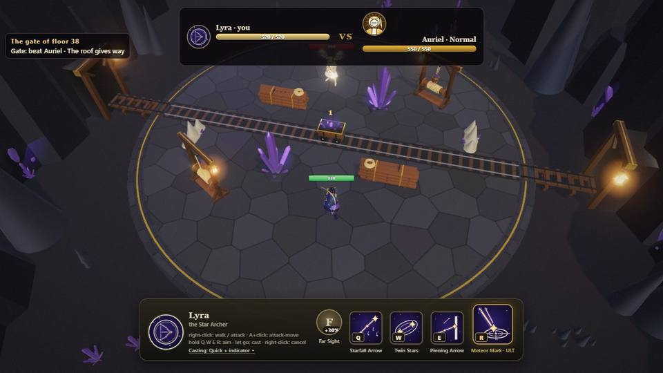

## Floor 38 · The Sunless Market

**Played through:** cleared with four stars in 1281 s of game time, no lives lost, nothing stuck, no errors (Light the Deep, the Ore
Bride and Slate-Eyes, the Lost Lantern, the Survey Lamp, Bring Dunn Up, Sefu's gallery, every waystone, cache and the lore stone, the
Dark Vault, the Gem Tyrant, Auriel at the gate). **Reachable:** all spots. **Read:** the names and lines fit; the ruler is the codex's
Gem Tyrant, on the seam model. **Props:** nothing in the air or through cover on walkable ground; the light under one side at the
edge is the mine entrances' beams against the wall, as on every Deep floor (looked at in the props pass and kept). **Frames:** about
7 ms at the camp and in the busiest fight.

### Fixed
- Nothing of its own.
