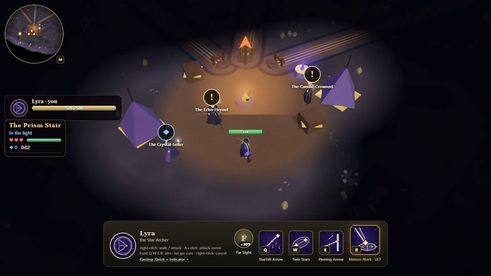
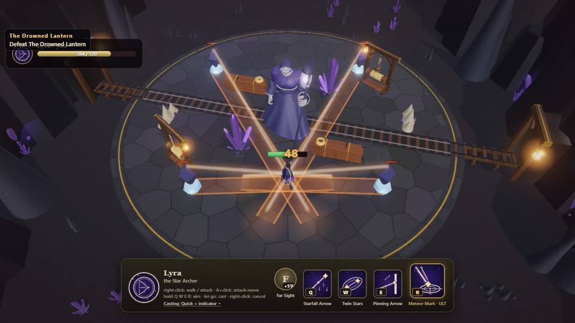
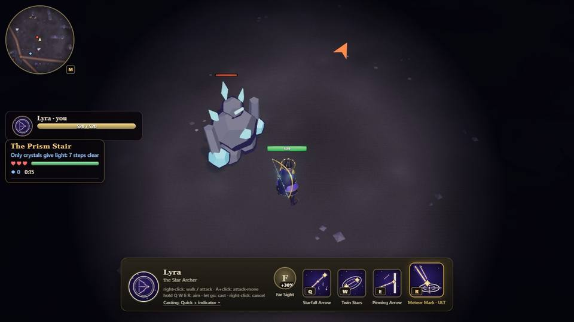

## Floor 39 · The Prism Stair

**Played through:** cleared with four stars in 1374 s of game time, no lives lost, nothing stuck, no errors (the Sleeping Halls, the
Night Shift and Widow Cobble, the Lost Lantern, the Survey Lamp, Bring Tobin Up, Silvane's gallery, every waystone, cache and the
lore stone, the Dark Vault, the Drowned Lantern, Bo at the gate). **Reachable:** all spots. **Read:** the names and lines fit; the ruler
is the codex's Drowned Lantern, on the lamp model. **Props:** nothing in the air or through cover on walkable ground. **Frames:** about
3 to 4 ms at the camp and in the busiest fight (five enemies).

### Small, left
- The miners' stone says the same as floor 31's ("The miners lit the crystals to find their way home...") and the man to bring up is
  Tobin, as on floors 32 and 37: the generator's short lists. Baked into the floor; left.
