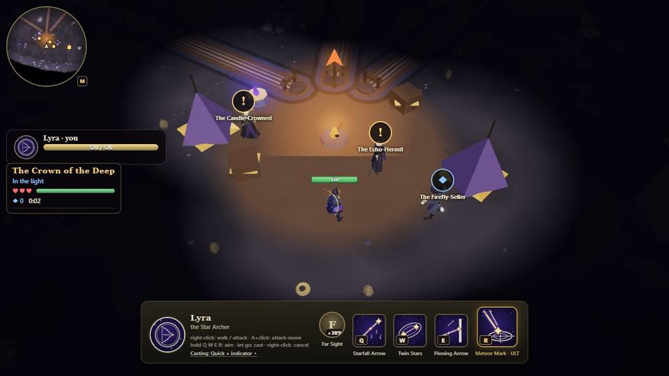
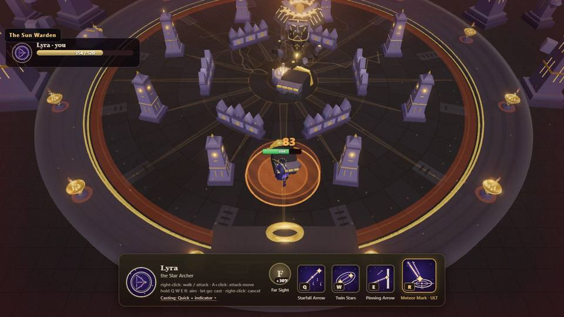
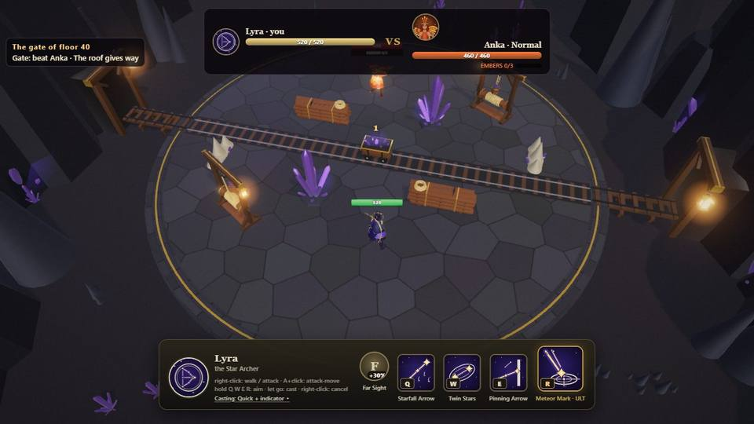
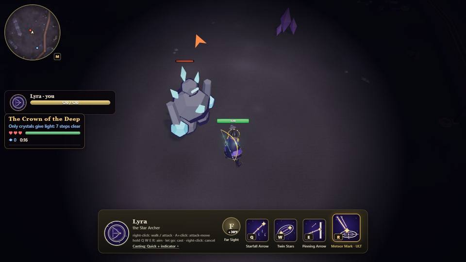

## Floor 40 · The Crown of the Deep (Chapter IV's crown)

**Played through:** cleared with four stars in 1587 s of game time, no lives lost, nothing stuck, no errors (the Sleeping Halls, the
Deep Bell and Captain Candle, the Lost Lantern, the Survey Lamp, Bring Dunn Up, Ada's gallery, every waystone, cache and the lore
stone, the Ore Cellar, the Sun Warden in the Sun Court, Anka at the gate). **Reachable:** all spots. **Read:** the crown is the codex's:
the Sun Warden, met a second time, fought as a Raid boss alone in his own court, on his Raid model; the keeper and the door name him.
**Props:** nothing in the air or through cover on walkable ground. **Frames:** about 5 ms at the camp and in the busiest fight.

### Left (in the list for the user)
- **In every ruler's fight the piece's title box covers the hero's name** (all chapters): "The Prism Mother / Defeat The Prism Mother"
  lies over "Lyra - you"; on the crown, "The Sun Warden" over it. The gate duels are fine (their bar is in the middle). The box is the
  set pieces' (`src/tower/world/pieces/hud.ts`, not mine to change this round).

