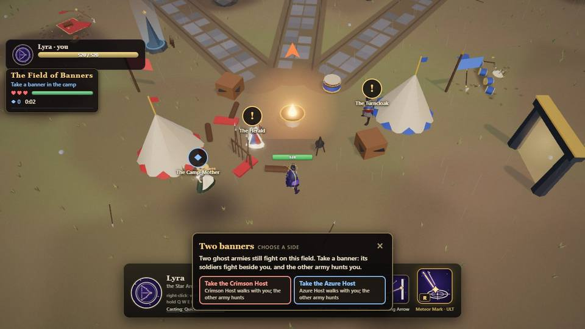
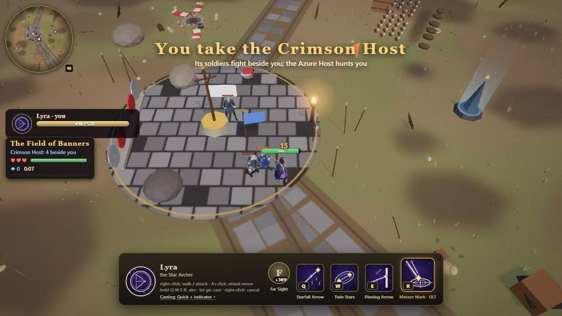
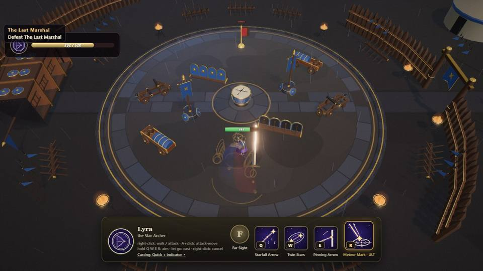
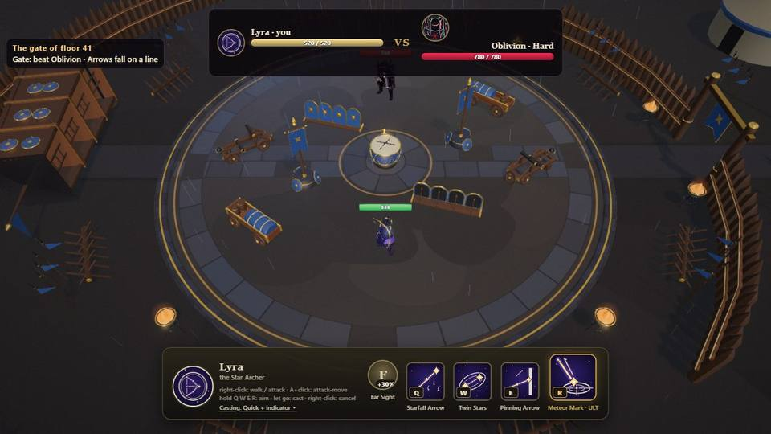
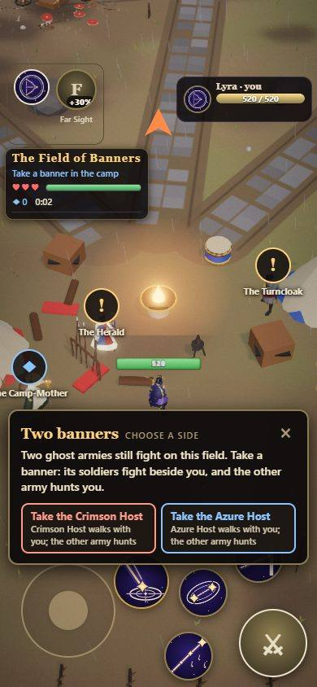
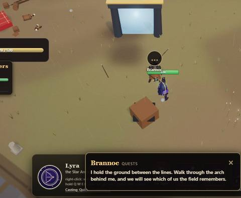
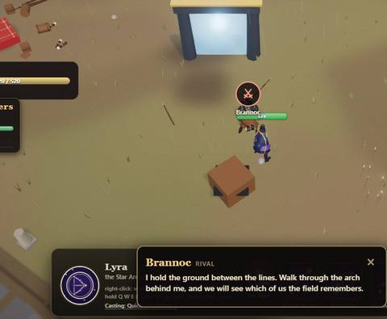

## Floor 41 · The Field of Banners (Chapter V opens)

**Played through** (two runs): the first cleared with three stars in 1229 s after losing the gate to Oblivion (Hard) eight times and
starting the floor over once; the second, after the fix below, with four stars in 1076 s, every piece on the first try. No errors,
nothing stuck in either. Everything done: Break the Siege (three standards, the hill held, the siege line), the Deserter Knight, the
White Cloth, Braziers for the Dead, Brannoc's ground, six waystones, six caches, the lore stone, the Trench, the Last Marshal, Oblivion.
**The two armies:** before a banner is taken both stay off the field (by design); after the Crimson Host, four crimson soldiers march
beside the hero and the azure packs hunt, as the law says. **Reachable:** all spots. **Read:** the Herald, the Turncloak (a deserter of
both banners) and the Camp-Mother say what the codex says of them; the ruler is the Last Marshal on his own model. **Props:** nothing in
the air or through cover; at the edge the palisade's rails stand on their posts. **Frames:** about 4 ms at the camp, 7 ms in the busiest
fight (phone timings for this floor are in STATUS).

### Fixed
- **Brannoc was marked as a quest giver** although he only hosts the duel: his card said "Quests" with nothing to take, and his mark
  showed "…" ("nothing for you"), so nothing told a player there was a duel here. He is now the floor's rival, like every rival on floors
  42 to 50: "⚔" over him and "Rival" on his card (same words), and after the duel his card says how it went
  (`src/tower/world/floors/banners-made.ts` and the generator it is baked from, `src/tower/world/gen/war.ts`: one word each).

### Noted
- Lyra lost the gate to Oblivion (Hard) eight times in the first run and none in the second: the gate is the chapter's hardest fight,
  and the route bot's numbers swing. Balance is not this round's to change.
