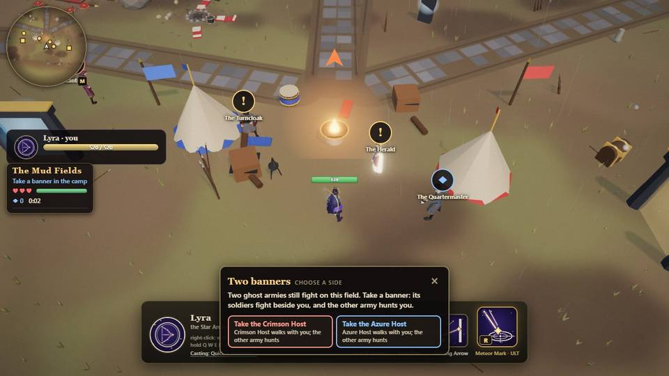
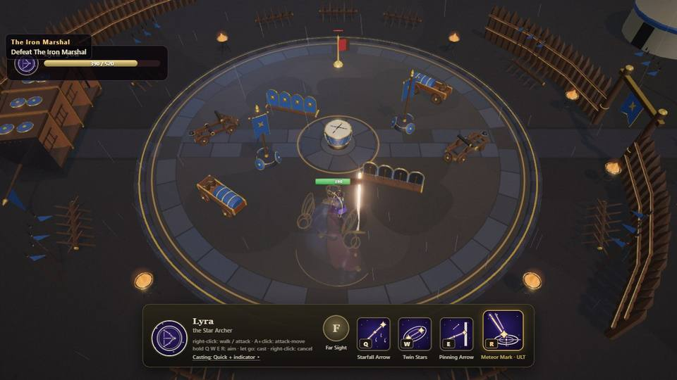
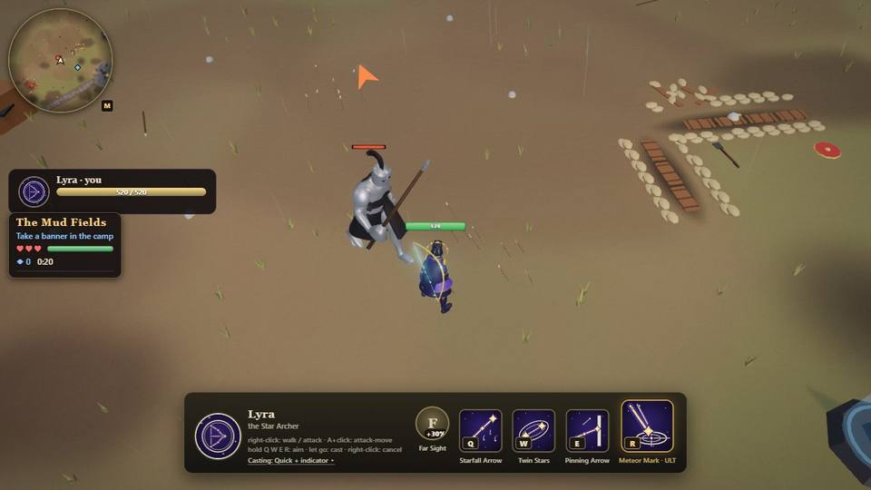
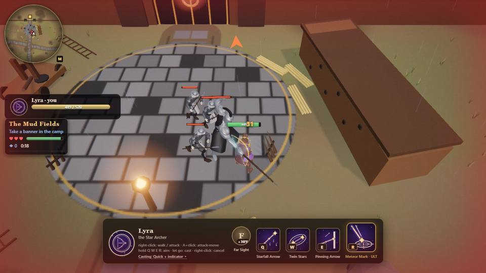
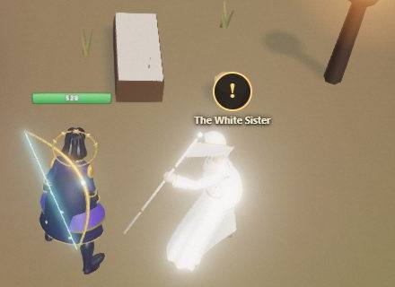

## Floor 42 · The Mud Fields

**Played through:** cleared with four stars in 967 s of game time, no lives lost, nothing stuck, no errors (Break the Siege, the
Turncoat and Sir Rust, the White Cloth, Dace's Cart, Braziers for the Dead, Cantor's ground, every waystone, cache and the lore stone,
the Trench, the Iron Marshal, Sirix at the gate). **Reachable:** all spots. **Read:** the Herald, the Turncloak, the White Sister ("I mend
whoever is carried in, whatever the colour") and the Quartermaster fit the codex; the siege's elite is the Ash Captain, as the
bestiary says. **Props:** nothing in the air or through cover. **Frames:** about 5 ms at the camp and in the busiest fight.

### Left (in the list for the user)
- **The Iron Marshal's title** is "Two banners, one sword" and his last phase "Under no banner"; the codex makes him the crimson's
  marshal (Orlan's cousin), and "both banners" is the Last Marshal's. Words, so yours to choose.
- **The White Sister, the Herald and the Camp-Mother read as white shapes** in the War's sun: their white robes go to pure white, with no
  folds or face from the game's camera. It was already so in the line-up picture you accepted, so I left it.

