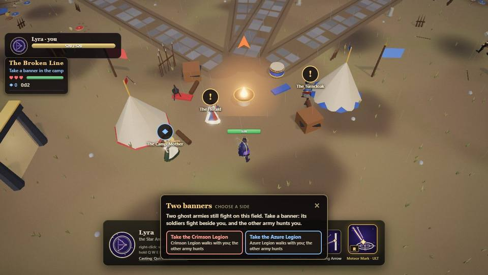
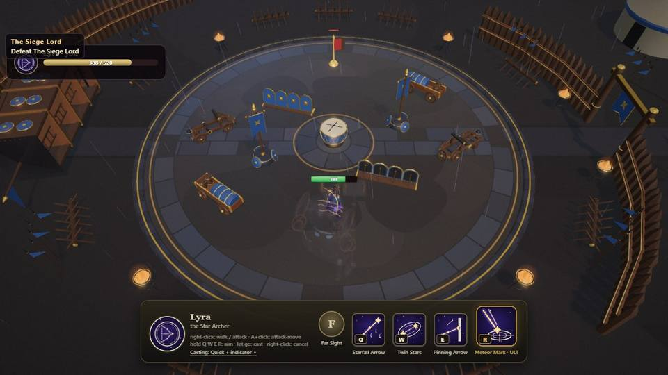
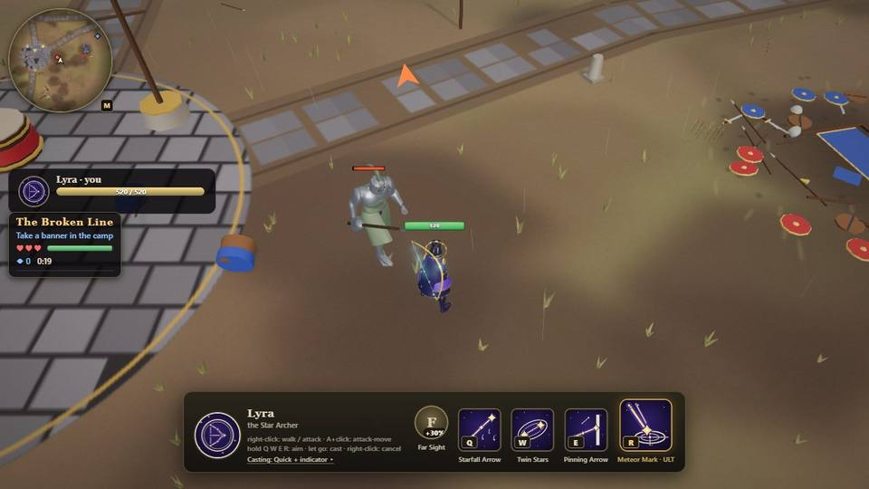
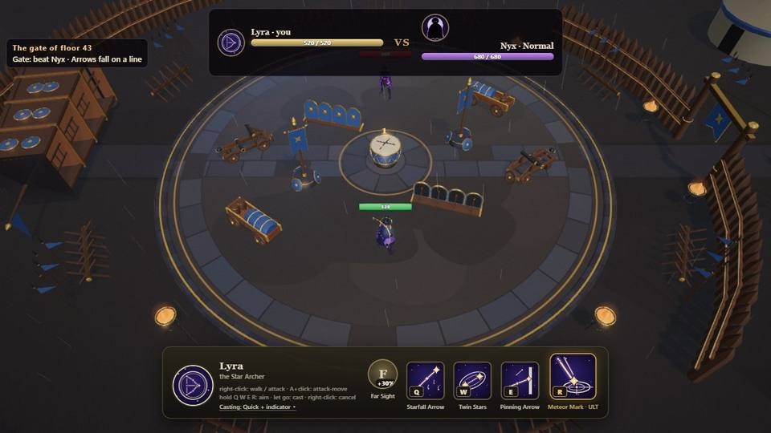
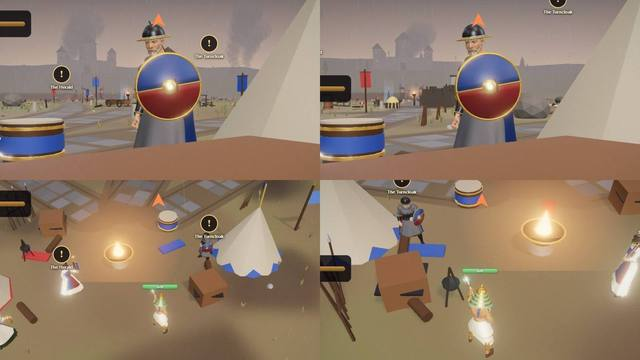
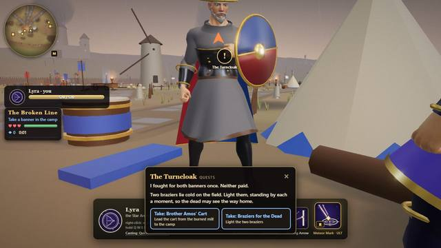
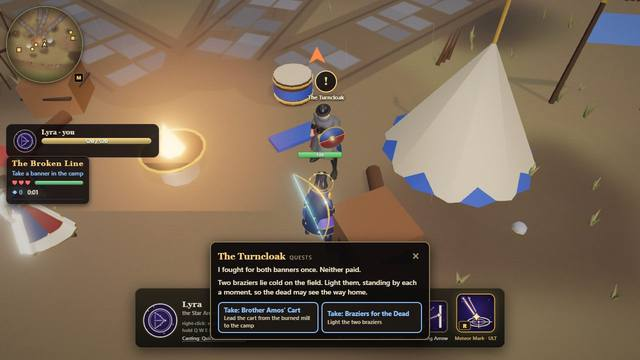

## Floor 43 · The Broken Line

**Played through:** cleared with four stars in 1021 s of game time, no lives lost, nothing stuck, no errors (Through the Line, the
Hollow Captain and the Crow Knight, the White Cloth, Brother Amos' Cart, Braziers for the Dead, Bram's ground, every waystone, cache
and the lore stone, the Muster Ground, the Siege Lord, Nyx at the gate). **Reachable:** all spots. **Read:** the people fit the codex
("I fought for both banners once. Neither paid."); the ruler is the codex's Siege Lord on the siege model. **Props:** nothing in the
air or through cover (one pebble half in a rock). **Frames:** about 4 ms at the camp, 7 ms in the busiest fight.

### Fixed (after the round, from the model review)
- **The Turncloak stood against the tent's side.** Moved 1.2 m toward the fire, as on floor 42 (every made War floor).

### Left (in the list for the user)
- The Siege Lord's last phase is called "Alone on a horse of smoke", the Last Marshal's own end in the codex: the generator picks the
  last phase's name from three at random (see the list for the floor-by-floor proposal).
