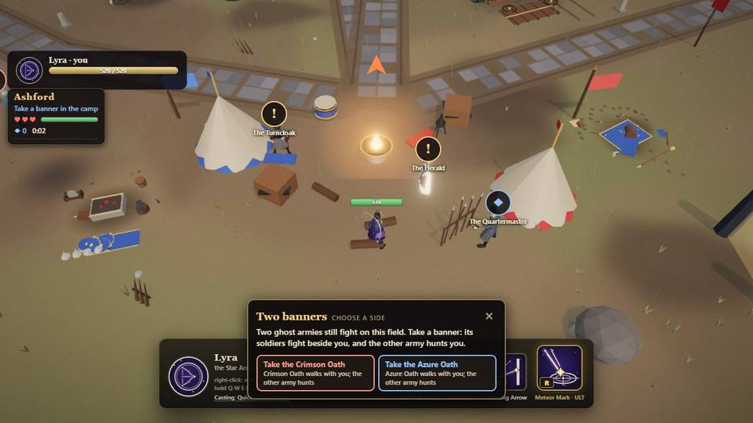
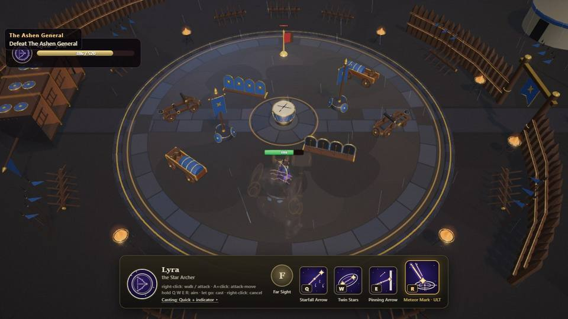
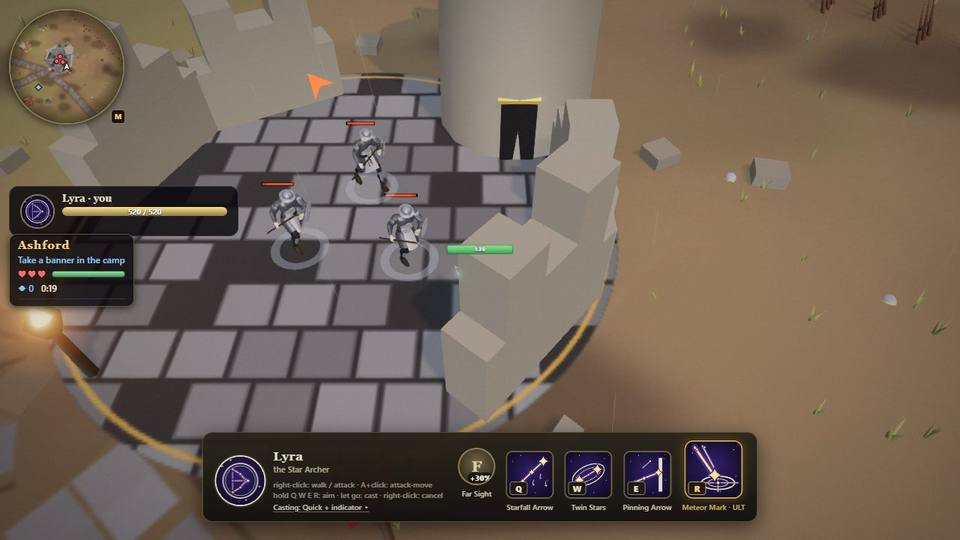
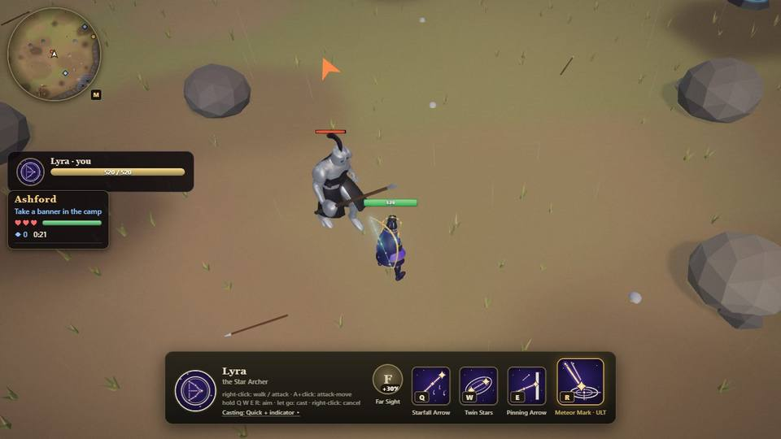

## Floor 44 · Ashford

**Played through:** cleared with four stars in 1002 s of game time, no lives lost, nothing stuck, no errors (Through the Line, Old
Ironside and the Weeping Lancer, the White Cloth (held by the ashen soldiers in the keep), Young Pell's Cart, Braziers for the Dead,
Kaia's ground, every waystone, cache and the lore stone, the Sapper's Tunnel, the Ashen General, Gus at the gate). **Reachable:** all
spots. **Read:** the people and names fit the codex (here the siege is led by the Grey Sergeant: the codex says the Ash Captain leads it
"on most floors"); the ruler is the Ashen General on the siege model. **Props:** nothing in the air or through cover. **Frames:** about
4 ms at the camp, 5 ms in the busiest fight.

### Fixed
- Nothing of its own.
