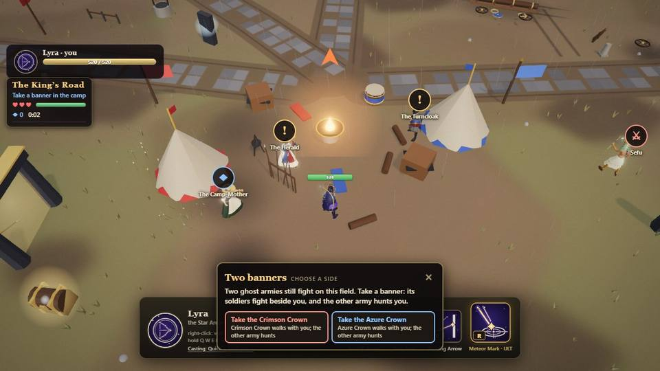
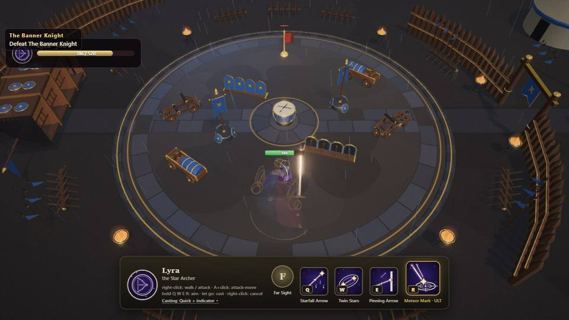
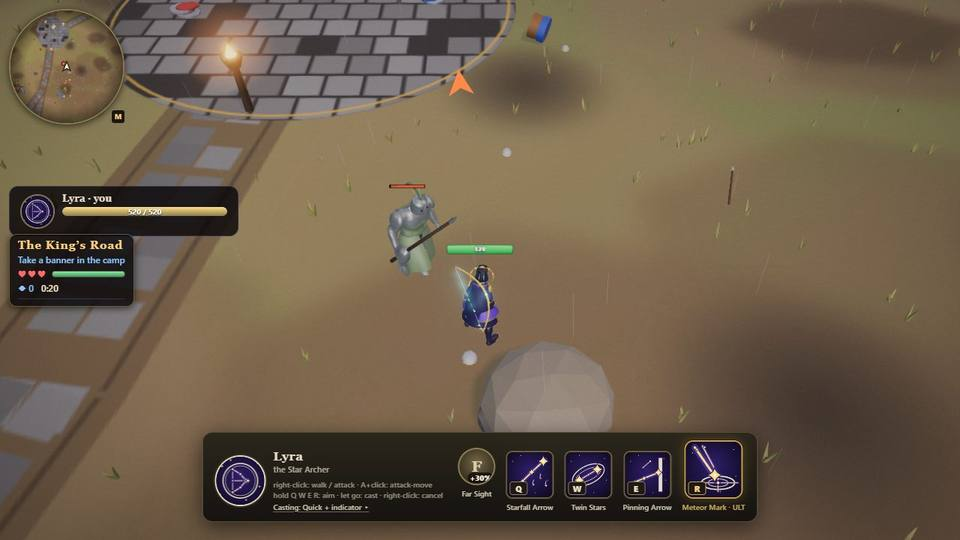
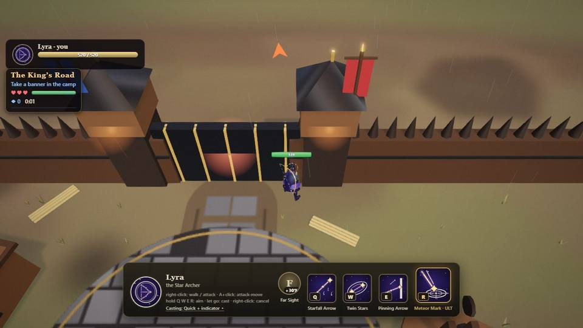

## Floor 45 · The King's Road

**Played through:** cleared with four stars in 939 s of game time, no lives lost, nothing stuck, no errors (the Three Standards, the
Last Sergeant and the Black Standard, the White Cloth, Rook's Cart, Braziers for the Dead, Sefu's ground, every waystone, cache and
the lore stone, the Sapper's Tunnel, the Banner Knight, Hank at the gate). **Reachable:** all spots. **Read:** the names and lines fit
the codex ("The field gives nothing back. Except the dead, every morning."); the ruler is the Banner Knight on the marshal model.
**Props:** nothing in the air or through cover. **Frames:** about 5 ms at the camp, 7.5 ms in the busiest fight.

### Fixed
- Nothing of its own.
