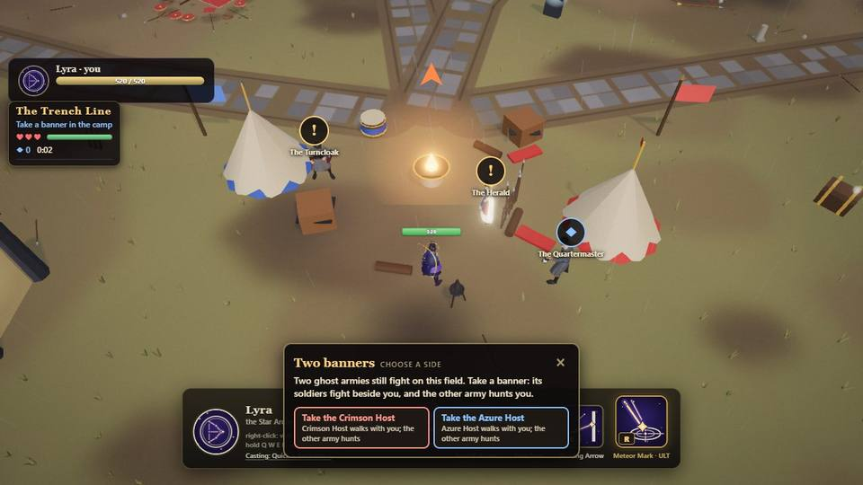
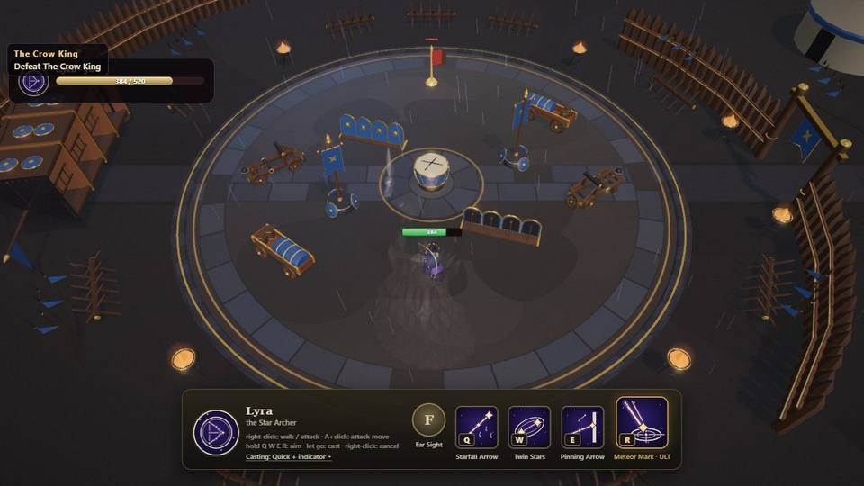
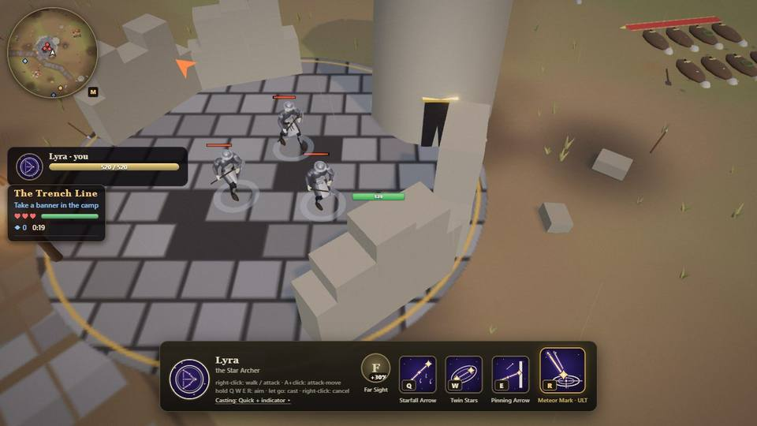
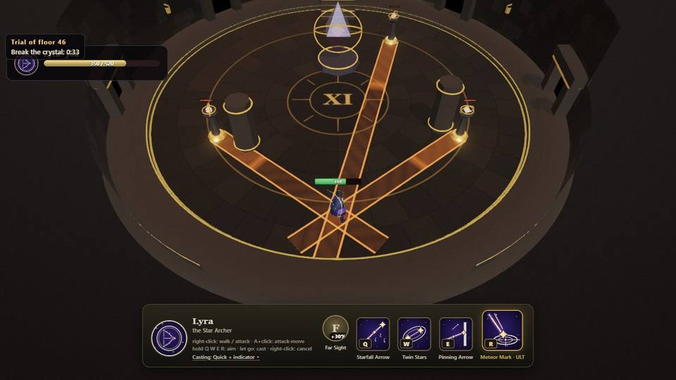

## Floor 46 · The Trench Line

**Played through:** cleared with four stars in 1038 s of game time, no lives lost, nothing stuck, no errors (the Three Standards, Sir
Ashes and the Grey Rider, the White Cloth, Dace's Cart, Braziers for the Dead, Pip's ground, every waystone, cache and the lore stone,
the Trench, the Crow King, Shiori at the gate). **Reachable:** all spots. **Read:** the names and lines fit; the lore stone ("The crows
came for the first battle and stayed. They have never been so fat, or so tired.") sits well under the Crow King, the codex's Gloaming
lord, on the crow model. **Props:** nothing in the air or through cover. **Frames:** about 4 ms at the camp and in the busiest fight.

### Small, left
- The cart to bring in is Dace's here and on floor 42 (the generator's short list), and the Grey Rider walks on foot (the champion's
  look). Baked into the floor; left.
