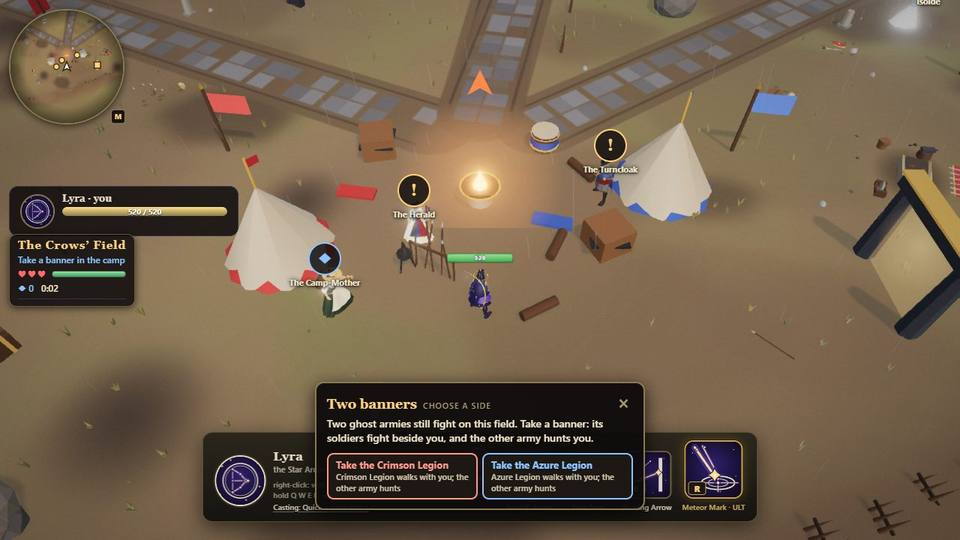
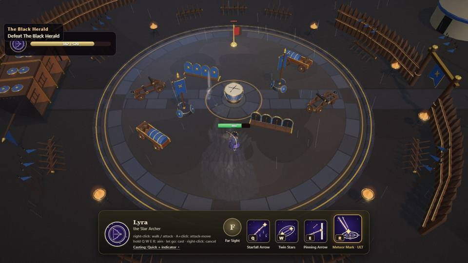
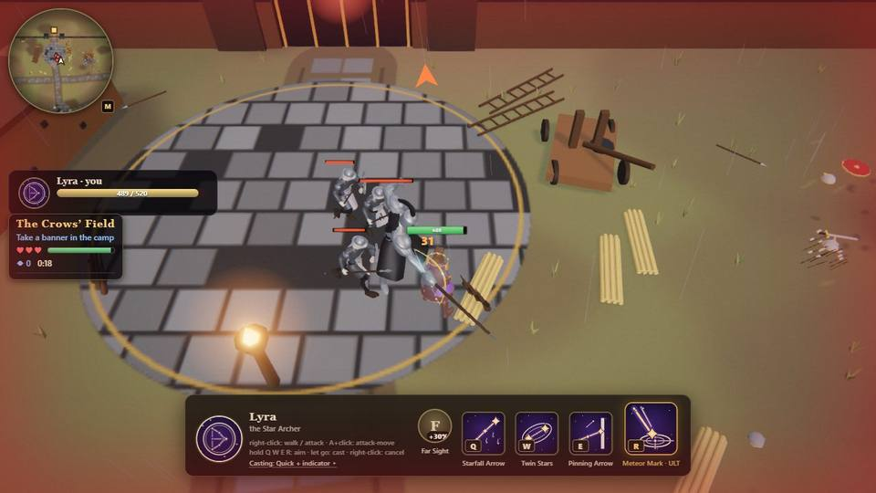
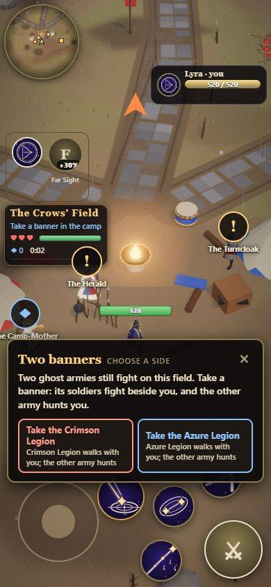

## Floor 47 · The Crows' Field

**Played through:** cleared with four stars in 1073 s of game time, no lives lost, nothing stuck, no errors (Break the Siege, the
Headless Herald and the Mud Mother, the White Cloth, Ilse's Cart, Braziers for the Dead, Isolde's ground, every waystone, cache and
the lore stone, the Sapper's Tunnel, the Black Herald, Anka at the gate). **Reachable:** all spots. **Read:** the names and lines fit;
the ruler is the codex's Black Herald, on the crow model. **Props:** nothing in the air or through cover. **Frames:** about 9 ms at the
camp and in the busiest fight (the machine was busy; nothing stands out).

### Left (in the list for the user)
- The Black Herald, the crimson's herald, fights "Under no banner" in his last phase (the War rulers' phase names, in the list).
