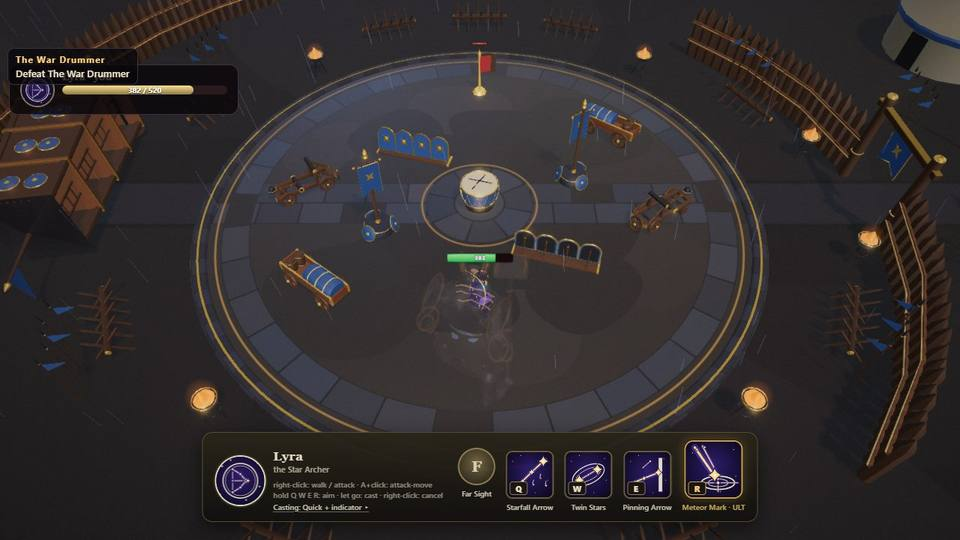
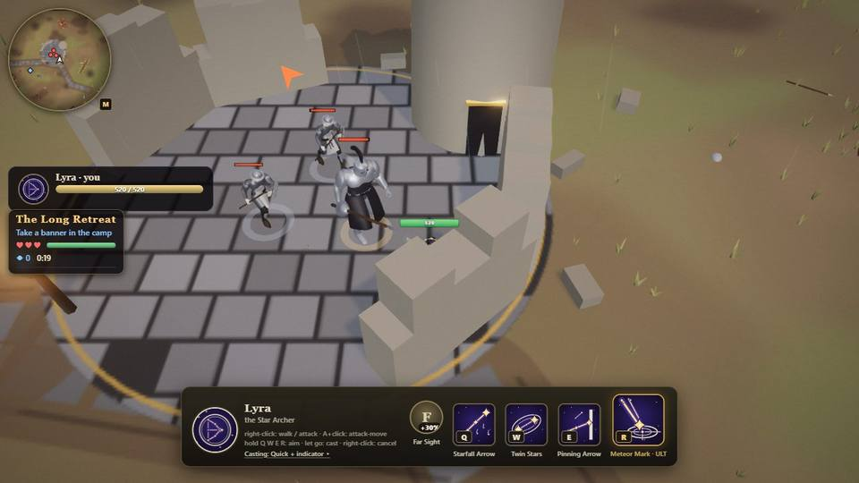

## Floor 48 · The Long Retreat

**Played through:** cleared with four stars in 1077 s of game time, no lives lost, nothing stuck, no errors (the Three Standards, the
Broken Oath and Sir Nobody, the White Cloth (the keep held by the Grey Sergeant), Tobin's Cart, Braziers for the Dead, Silvane's
ground, every waystone, cache and the lore stone, the Sapper's Tunnel, the War Drummer, Tempo at the gate). **Reachable:** all spots.
**Read:** the names and lines fit; the ruler is the codex's War Drummer, on the siege model. **Props:** nothing in the air or through
cover; the boards at the south edge with one end on the ground are the stake barricades, leaning as built. **Frames:** about 4 ms at
the camp and in the busiest fight.

### Fixed
- Nothing of its own.
