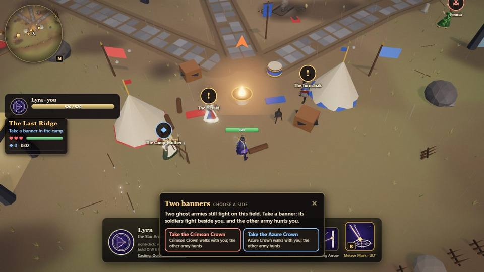
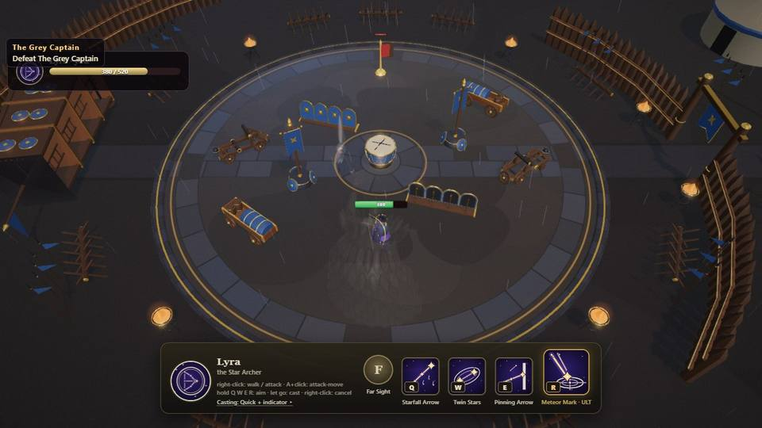
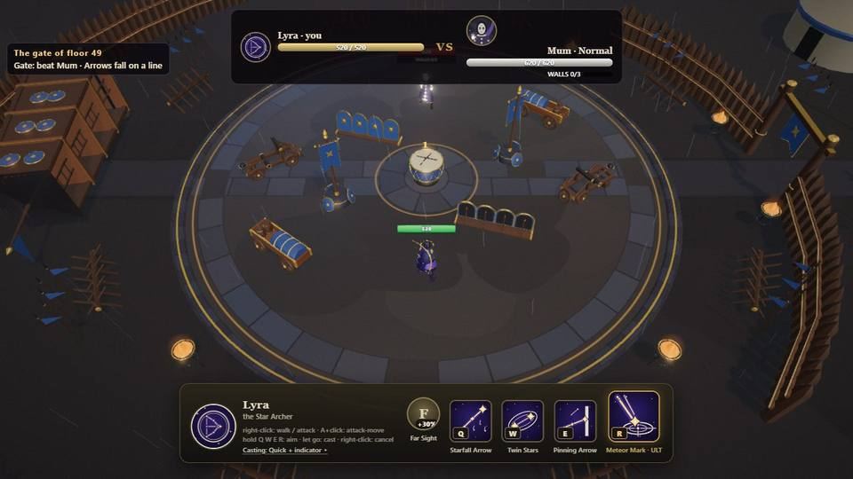
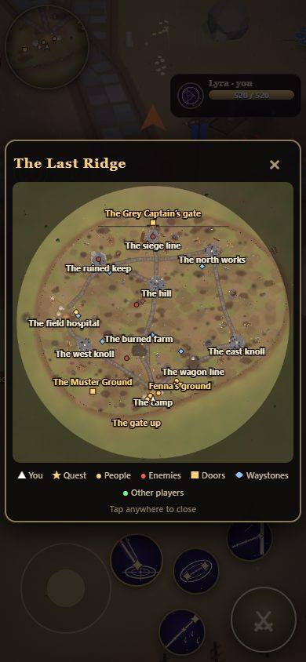

## Floor 49 · The Last Ridge

**Played through:** cleared with four stars in 1024 s of game time, but only after losing the gate to Mum eight times and starting
the floor over once (the bot is Lyra at the balance level; balance is not this round's). No errors. Everything done: Through the Line,
the Iron Widow and the Lost Colonel, the White Cloth (the keep held by the Banner Bearer), Old Merrin's Cart, Braziers for the Dead,
Fenna's ground, every waystone, cache and the lore stone, the Muster Ground, the Grey Captain, Mum. **Stuck?** Twice the bot stood
45 s at the north edge (-0.5, -96.5) on its way to the gate in the south. Tried again from each of the six waystones with the ruler
won: every time the hero walked straight to the gate and in (18 to 42 s). Not a spot on the floor. Most likely the route tool: it gives the
bot a goal only when its task changes, and after a lost gate the zone is built again with the same task, so the new bot waits for the
tool's 45 s nudge. **Reachable:** all spots. **Read:** the names and lines fit; the ruler is the codex's Grey Captain on the crow model.
**Props:** nothing in the air or through cover. **Frames:** about 6 ms at the camp, 7 ms in the busiest fight. **Phone:** usable; the
map's names stand apart.

### Left (in the list for the user)
- The Grey Captain's last phase is "Alone on a horse of smoke" (the War rulers' phase names, in the list).
