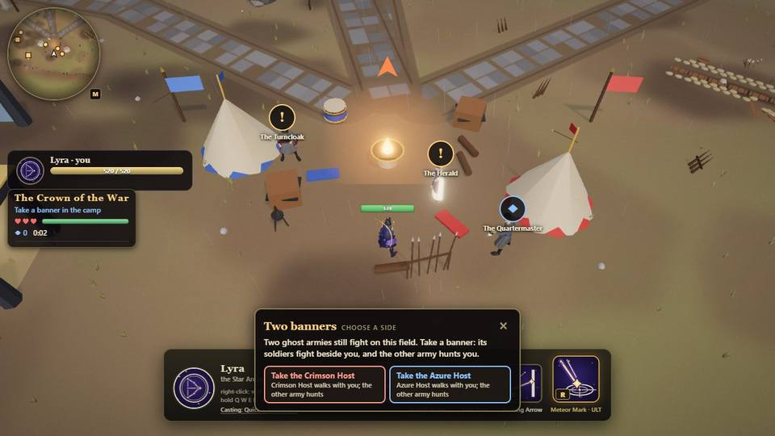
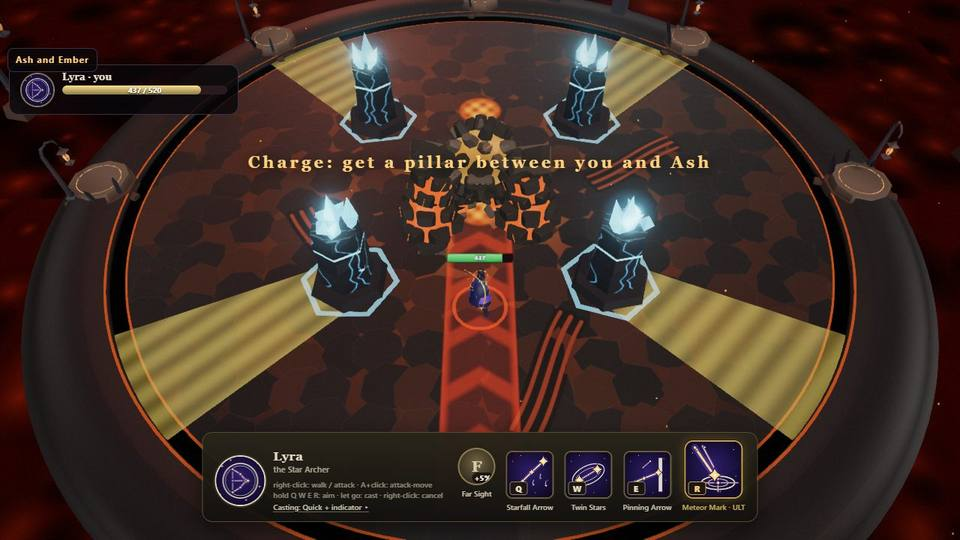
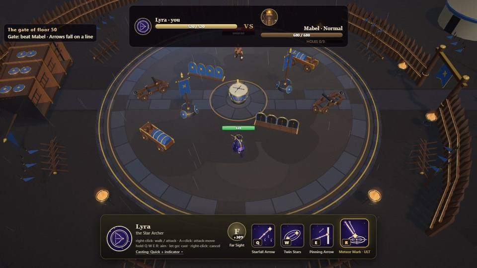
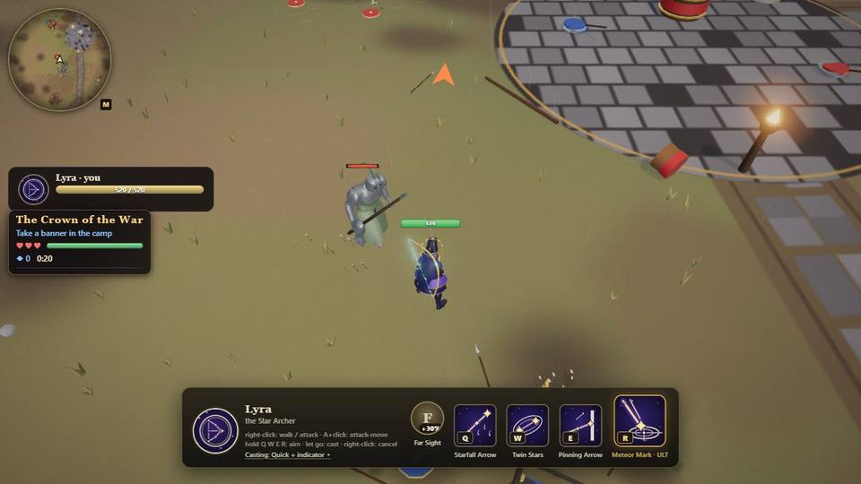
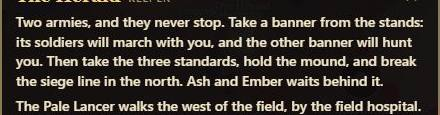
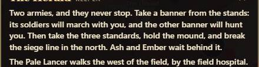

## Floor 50 · The Crown of the War (the top of the Climb)

**Played through:** cleared with three stars in 1153 s of game time (one life lost at the gate to Mabel, won on the second try), no
errors, nothing stuck: Through the Line, Mother Crow and the Pale Lancer, the White Cloth (the keep held by the Standard Bearer),
Hale's Cart, Braziers for the Dead, Ada's ground, every waystone, cache and the lore stone, the Sapper's Tunnel, Ash and Ember in the
Cinder Pit, Mabel at the gate. **Reachable:** all spots. **Read:** the crown is the codex's: Ash and Ember, the last sparks of the sun,
fought as a Raid boss alone on its Raid model, behind "The Burning Gate". **Props:** nothing in the air or through cover. **Frames:**
about 10 to 13 ms at the camp and in the busiest fight (the machine was busy then; floor 49 next to it was 6 to 7 ms).

### Fixed
- **Ash and Ember were spoken of as one**: "Ash and Ember waits behind it", "is behind it", "once Ash and Ember has fallen", "Ash and Ember
  wakes". The codex says they burn, two embers: now "wait", "are", "have fallen", "wake" (the floor's baked file
  `src/tower/world/floors/gen/war-50.ts`, and the generator `src/tower/world/gen/war.ts` says it the same way for a ruler of two).

