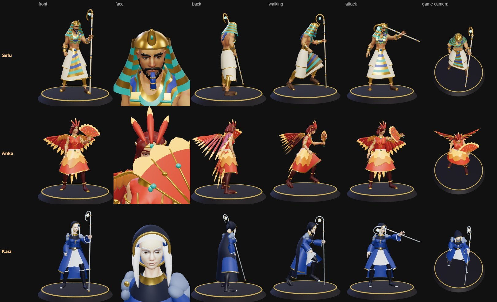
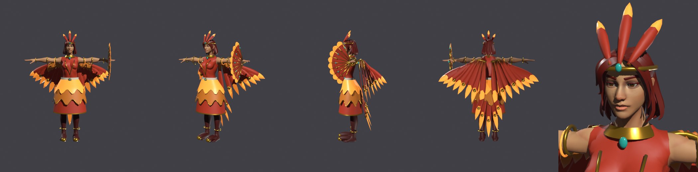

# Anka, the Firebird

The first hero made by [the rules for creating a hero](../../docs/pipeline/new-hero.md). The user picked her from
four ideas on 2026-11-11: "Phoenix fire dancer: the first true fire hero, a mage in ember-red and gold with flame
wings and a fan. Feather darts, a fire trail dash, and once per round she rises from her ashes."

## Gate 1: the card

| | |
|---|---|
| **Sentence** | A fire dancer who rises once from her own ashes. |
| **Shape** | The long feather with an eye near its tip: a gold shaft, an ember-red vane, a small teal eye. Every spell is made of them. |
| **Colours** | Ember red `#c23a22` and gold `#e0a935` with flame `#ffb54a`; foil: pale ash `#eadcc4`; one small accent, the teal `#2fb8a8` of the feather's eye. |
| **Theme word** | `phoenix` |
| **Role** | Mage, ranged, fragile. |
| **The new thing** | **A second life that the enemy can take away.** Her feathers stay on the floor as embers. When she would fall, she turns to ash and rises again at an ember. No ember, no second life: the enemy can stamp embers out by walking over them. No hero has a revive, and no hero's life depends on things lying on the floor. |
| **The question she asks** | Do you chase her, or do you first stamp out her embers? |
| **Her weakness** | Without an ember she is the most fragile mage in the game, and every feather she lays as an ember is a feather not thrown at you. Embers lie still: anyone can walk to them. |
| **Her second decision** | Each ember is damage now or a life later: her fan can make every ember flare (it burns out), or she can keep it. And she rises where the ember lies, so where she leaves them decides whether the enemy is waiting there. |
| **How she looks** | A slender dancer in an ember-red bodice and a feathered skirt, bare arms with gold bands, long dark-red hair under a gold circlet with a three-feather crest. Two wings of flame feathers swept down and back from her shoulder blades like a cloak (not raised like Auriel's), a train of five long tail feathers with eyes, and an open feather fan held up in her left hand. |

**Nearest heroes, and why she is not them.** Brannoc (the Ashen Smith) has the fire colours: molten orange under a
black crust, with iron and ash. Anka has no black and no metal but gold: feathers, not slag. Vesper is crimson with
bone. Auriel has wings: raised, pale plates of light, on armour. Fenna's flowers and Kaia's rods also lie on the floor
and can be trampled or touched; none of them is a life.

## Gate 2: the look

Model: `blender/heroes/real/phoenix.py` -> `public/models/heroes/phoenix_v4.glb` (600 KB). Built 2026-11-11; the user: "yes this look
good".

The fan is in her LEFT hand, upright (`hold: 'torch'`), as a staff or wand is: the pack's attack for a caster is
the left hand's push, so in the right hand the fan stayed at her side while the empty left hand struck.

## Gate 3: the kit on paper

Written 2026-11-11 after the user's yes to the look ("yes this look good", "lets make some interesting kit for her").
Waiting on the user's yes; nothing of it is built.

**The idea in one line:** everything she does lays embers on the floor or spends them. An ember is three things at
once: a blast (W), a place to fly to (E), and her second life (the passive). She has three at most, and the enemy can
stamp them out.

Anka. Theme `phoenix`. Mage, ranged. **480 HP** (the lowest in the game; with her second life 624), 4.2 m/s, attack
6.5 m, 12 per 1.0 s (a feather flicked from the fan). Accent `#ff7b3a`, foil `#eadcc4`.

| Key | Spell | CD | Rule | Answer, checked |
|---|---|---:|---|---|
| P | **Ashborn** | once a round | **Embers:** 3 at most, 12 s each; a fourth puts out the oldest. The newest is her **nest** and wears a small crown of flame, for both players. An enemy who stands within 1 m of an ember for 0.6 s in all stamps it out. **The second life:** a hit that would fell her while a nest burns turns her to ash instead: she is gone for 1.2 s (nothing hits her, she does nothing), an egg glows at the nest, and she rises there with 30% HP (144) in a flare of 2.2 m: 40 and a 2 m push. All embers go out | Stamp the nest first: the crown shows which. Or wait 3 m from the egg: she rises at a known spot at a known moment with 144 HP. The flare shows for 1.2 s; leaving it takes 0.8 s |
| Q | **Ember Quill** | 3.5 | A feather (10 m, 22 m/s, 0.3 s wind-up): 58. Where it ends, in you or in the floor, it stays as an ember and becomes the nest | Sidestep: it reaches 6 m at 0.57 s. A quill that hits you leaves her nest at your feet: stamp it |
| W | **Fan the Flames** | 9 | No aim. One sweep of the fan: every ember flares after 0.8 s in a ring of 2.2 m: 60 (once, however many rings you stand in). The embers burn out | Step out: 2.2 m takes 0.8 s with reaction, from the very middle. After it she has no ember and no second life until the next quill lands |
| E | **Ember Flight** | 10 | She turns to feathers and flies to her ember nearest the aimed spot (12 m): 0.25 s to go, 0.45 s in the air. She lands in a burst of 1.8 m: 40. The ember is spent. With no ember it cannot be cast | The landing is an ember you could see before, and the burst needs 0.7 s: stepping out takes 0.7 s. Stamp the ember near you and she cannot come |
| R | **Firebird** | 24 | She spreads wings of fire for 1.0 s (the lane shows), then crosses 12 m as a great firebird in 0.5 s: 120 to everyone in the 3 m lane. She lands at the far end. An ember is left where she took off, and becomes the nest | Leave the lane: 1.5 m takes 0.63 s with reaction. Then she stands beside you with 480 HP: hit her, or run to the ember she left and stamp it before she flies back |

**The question:** chase her, or stamp her embers first? **Weakness:** 480 HP, and every stamped ember takes away a
blast, an escape and a life at once. Right after Fan the Flames she has nothing. **Second decision:** each ember is a
blast now, a flight later, or her life; and a quill that hits moves her nest to the enemy's feet, so her best poke is
also her worst nest.

**What makes her interesting to play.** Firebird through the enemy and Ember Flight back to where she took off: in
and out in two buttons, unless the enemy stamps the ember in between. A quill thrown past the enemy on purpose is a
nest behind them and a place to fly to. Stamping takes 0.6 s of standing still next to an ember that can flare in
0.8 s: whoever starts first wins that race, and both can see it.

**What makes her interesting to fight.** Her whole plan lies on the floor in plain sight: where she can blast, where
she can fly, where she will come back to life. No other hero shows the opponent that much, and no other hero has to
be killed in the right place.

### Checked with the numbers (rule 4)
- A hero walks 4 m/s and reacts in 0.25 s; a circle warns at least `0.25 + radius / 4`; a bolt reaches 6 m no sooner
  than 0.5 s.
- Q: 0.3 + 6 / 22 = 0.57 s to 6 m. OK.
- W: 2.2 m needs 0.25 + 0.55 = 0.80 s; it warns 0.8 s. OK, with nothing to spare from the centre.
- E: 1.8 m needs 0.70 s; the landing comes 0.70 s after the cast. OK.
- R: the lane is 1.5 m to each side: 0.25 + 0.375 = 0.63 s; it warns 1.0 s. OK.
- The rise: 2.2 m needs 0.80 s; the egg shows 1.2 s. OK.
- Stamp against flare: 0.6 s against 0.8 s. An enemy already standing on an ember when she casts W stamps it first.

### Budget (pipeline/designs/kit-common.md)
Mages have 560-580 HP; hers is 480 because a second life is sustain, the strongest thing in a duel. 144 HP once a
round is far above the limit for a heal (50 on an R): it is allowed only because the enemy can take it away, and the
balance run decides both numbers. Damage: Q 58 every 3.5 s is her rhythm; W 60 and E 40 need embers in the right
place; R 120 is below the usual 125-130 because it also moves her and lays a nest.

### What the engine has, and what is to be proven at gate 4
- **Embers** are records in a WeakMap keyed by her figure, written by the spells on both screens at the moment a
  quill ends or she takes off, drawn by `Trait.marks` (kinds `ember`, `nest`, `egg`). Stamping copies Fenna's
  flowers: `victimTick` on the victim's screen counts the time, removes the ember and tells her client with
  `noteOwner('stamp', id)`.
- **Where a quill ends** must be the same on both screens: a hit is decided on the victim's screen only. To be
  proven: the ember of a quill that hit is laid where the hit landed (told with the hit), one that missed at its end
  point, which both screens work out alike from the cast.
- **The second life** is decided in `taken`, on her own client, which knows her real HP and her embers: the hit is cut
  to leave 1 HP (as Sir Whiskers's Land on My Feet does), she is `sealed` and not drawn (`figureHidden`) for 1.2 s,
  which is the longest the engine seals anyone, moved to the nest (`moveTo`) and healed (`heal`). The other screen
  learns it by `show('ash', id)`. The flare is a hit from a passive (`hitEnemy`), decided on the victim's screen.
- **Ember Flight** is a dash (`ctx.moveCaster`) with a telegraph at the ember. She can be hit in the air.
- **Firebird** is a dash with a line telegraph; the cast roots her for the 1.0 s.
- **No new engine piece is needed** as far as reading shows. If the quill's end point cannot be agreed by both
  screens, the fallback is that an ember is always laid at the quill's full reach, hit or miss.

### What the CPU does
- **As Anka:** quills whenever in reach. Fan the Flames only with the enemy within 2.2 m of an ember, and not while
  she is under 40% HP with a single ember (it is her life). Ember Flight to get away when the enemy is within 3.5 m
  and an ember lies more than 6 m from it; to attack when an ember lies within 1.8 m of the enemy and she is above
  half HP. Firebird with the enemy in the lane within 10 m. She walks to keep her nest behind her.
- **Against Anka:** walks to an ember within 3 m of it and stamps it (as it tramples Fenna's flowers), the nest
  first when she is under 30% HP.

### Names and files (checked free on 2026-11-11)
`emberQuill.ts` ('ember quill'), `fanTheFlames.ts` ('fan the flames'), `emberFlight.ts` ('ember flight'),
`firebird.ts` ('firebird'); `src/effects/parts/phoenix.ts`, `src/kits/phoenix.ts`, `src/traits/phoenix.ts`. Taken
already and not hers: `featherStep.ts`, `emberComet.ts`, `vermilionPhoenixDive.ts`, `cinderBow.ts`.

## Gate 5: the numbers after the first balance runs (2026-11-11)

Measured with the fight simulator (`python pipeline/sim/sim.py hero Anka`), against the six benchmark foes:

| Step | Change | Win % |
|---|---|---:|
| As on the sheet above | 480 HP, Q 58, W 60, rise 30%, stamp 0.6 s | 25-29 |
| Embers the CPU can use | a new ember cannot be stamped in its first second; stamping takes 1.0 s | 69 |
| | rise 25% (115 HP), W 54 | 63 |
| | Q 54 | 59 (192 fights) |
| **Now** | **460 HP** | **48 (192 fights, plus or minus 7)** |

The first row was not a weak hero but a kit that did not work against the CPU: a quill that hit left its ember
under the enemy, and the enemy stamped it (0.6 s) before Fan the Flames (0.8 s) or anything else could use it, so
she had no blast, no flight and no second life. With the grace second, W deals 3.6 damage a second, E 1.4, R 4.2.
By foe at the last step: Cantor 27 of 32, Brannoc 20, Isolde 15, Oblivion 13, Kaia 11, Sirix 6. No errors, no
fight without a winner. **Numbers now:** 460 HP; Q 54; W 54; E 40; R 120; rise 25% with a 40 flare; embers 12 s,
3 at most; stamping 1.0 s after the ember's first second. The sheet's table above keeps the first numbers.

## Gate 4: the spells

Built 2026-11-11 and shown to the user as [a page](../../docs/heroes/anka.html): her portrait and icons, and one
sheet of pictures per spell taken by the game in a real duel (`docs/spells/anka/`). Her rules and plain spells were
written and proven first (`src/traits/phoenix.ts`), then two helpers drew the effects and the kit art in parallel
against those frozen rules. What changed from the sheet above while building:

- The arena's own damage (its event, the closing floor, Last stand) passes no trait, so it kills her for good, in the
  egg too. Her passive's text says so.
- She is kept safe as ash by her own rule swallowing every hit, not by the `sealed` status (the engine refuses it in
  the half second after a stun, when most kills happen).
- The firebird's hit follows its beak as it is drawn: her slide is fast at first, so the first half of the lane is
  struck a little sooner than an even front would.
- Where a quill ends is worked out as Fenna's Seed Shot does it: where the bolt really stopped on the screen that
  decides the hit, along the aim on the other.
