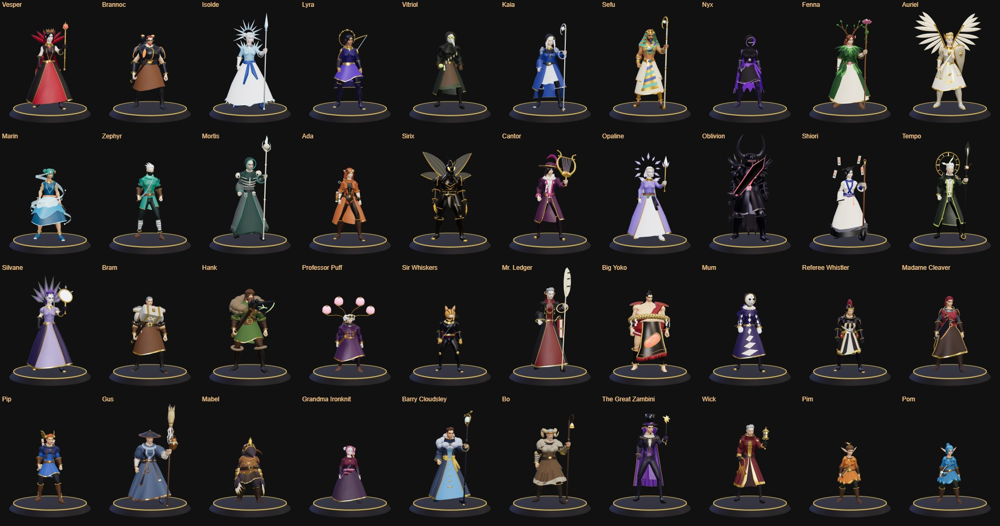
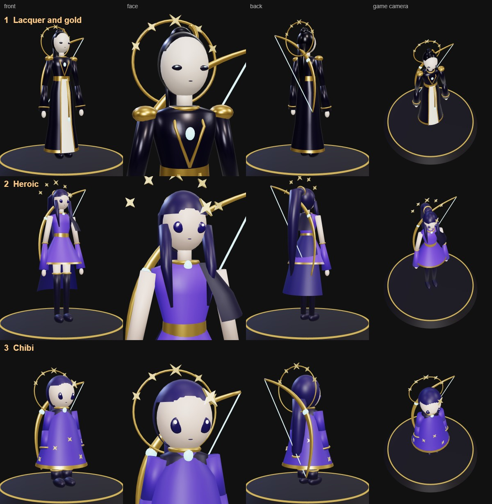
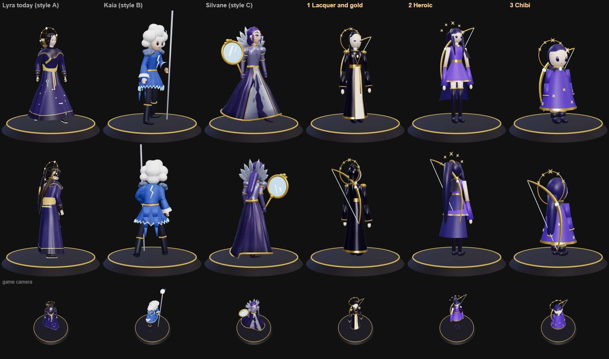
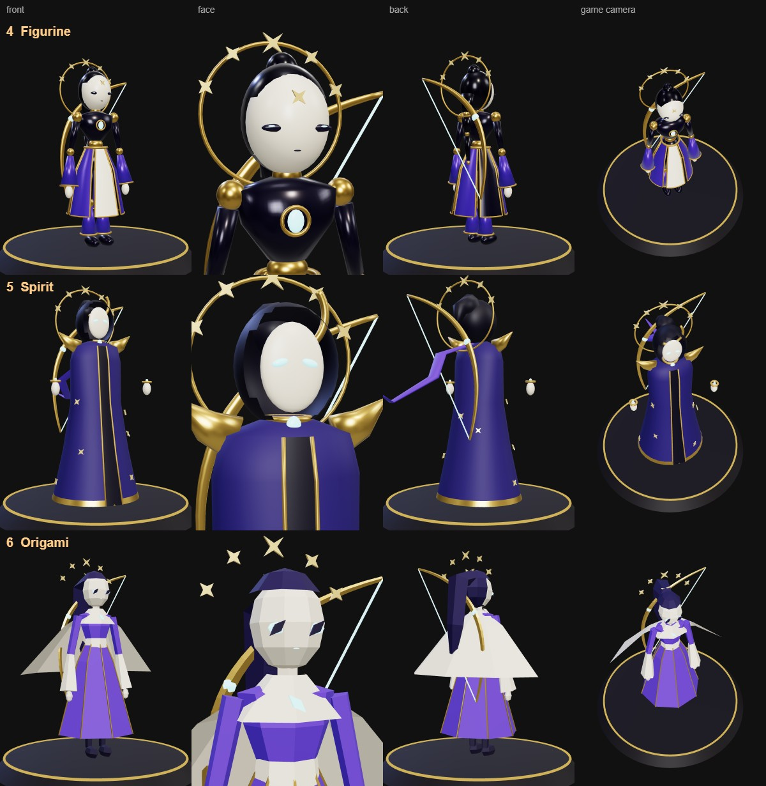
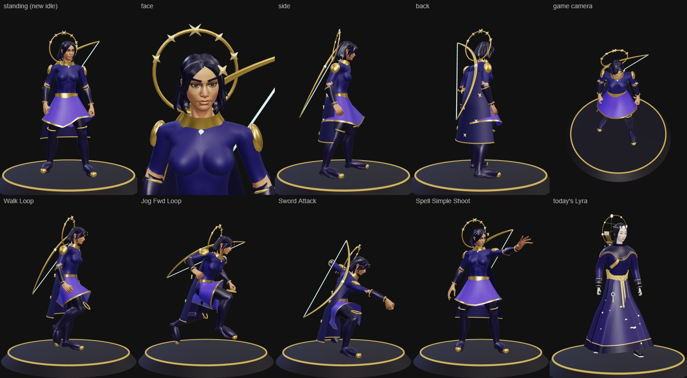
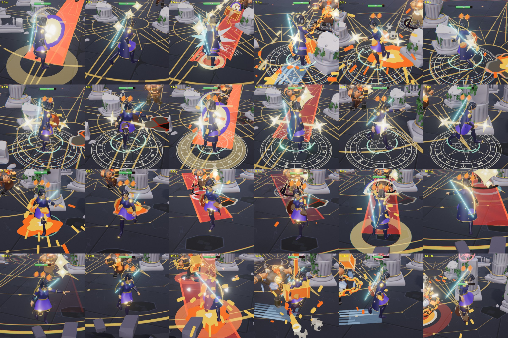

# One hero style (v4): directions to pick from

**Status (2026-11-10): built. Direction 7, "real", for all 39 heroes** (user: "yes and make all heroes like that",
then "this is good, make all heroes in that style"). All 40 models exist (the twins are two) and are the default; the
older models show with `?figs=old`. Not pushed, not deployed.

**How a hero is made now:** `blender/heroes/real/<theme>.py` has one `build()` that dresses a `Real`
(`blender/heroes/realkit.py`, shapes from `figkit.py`); `blender/heroes/real_build.py -- <themes> [--shots <folder>]`
writes `public/models/heroes/<theme>_v4.glb` and a check picture. Lyra, Brannoc, Sir Whiskers, Grandma Ironknit and
Isolde were built first as the proof (a plain one, a heavy one, a cat's head, a small old one, a bell skirt with a
spear); the other 35 in three parallel batches with shared helpers in `real/parts_a.py`, `parts_b.py`, `parts_c.py`.
`src/heroes.ts` `modelV4` maps each older model path to its `_v4` file; `REAL_STYLE` in `src/motion/real.ts` says who
holds what (the pack's torch arm for 17 staff, scepter, lyre, mirror and lantern holders; the shield arm for Auriel)
and who strikes how (fists, claws, a throw, Hank's chop).

**Checked:** all 40 load through `HeroFigure` with no error (the line-up above is that); every hero fought a 10 s AI
duel on the tool page against another, both on their new models: 39 fights, no errors; type check, build, server test.
**Not checked:** a person playing; a phone; the game page's own camera for every hero; each hero's every cast style.

**Known, for later:** one face per sex (the free pack), so faces repeat: heroes differ by skin tone, hair, build and
what covers the face. The 2D portraits and the catalog pages still describe the older models. `HERO_BODIES` (hit sizes)
are unchanged. Kit notes from the batches: a held staff's length is scaled by depth, not height (the batch helpers
correct it); `R.cape` and `R.ring` near the neck are unreliable on the male body; `Hair_Long` and `Hair_Buns` do not fit
the male head; the skin texture has painted underwear (cover it); `flat=True` on `R.mat` does not reach pieces.

The user: "as you can see heroes have different style, let's make one better". The 39 heroes come from three
generations: A, the 12 oldest (`hero_figures.py`: slim, small heads, plain robes: Lyra, Vitriol, Nyx, Fenna, Marin,
Mortis, Ada, Sirix, Cantor, Opaline, Shiori, Tempo); B, 8 remade (`moba_figures.py`, big heads and eyes); C, the 19
newest (the restyle). Asked which should become the one style, the user chose **a new style**, built with **new
stand-alone builders on this computer** (the old ones need a helper folder that is only on the first computer), with
**Lyra as the sample**.

The style itself was not described, so before modelling a full Lyra three rough blockouts were built: flat colours,
simple forms, no rig. Each is a direction to pick, mix or draw over.

| # | Direction | Proportions | Idea |
|---|---|---|---|
| 1 | Lacquer and gold | 6 heads, 1.75 m | The weapon look of `docs/ART_BIBLE.md` section 1 on a figure: dark lacquer body, gold structure, one cream face (the skirt panel), one glow (the chest gem and the bowstring). Calm, statue-like, a porcelain face with narrow eyes. |
| 2 | Heroic | 7 heads, 1.82 m | The anime finisher look of the user's reference videos: long legs, a layered asymmetric costume (short skirt, coat tail, a cape off one shoulder, thigh boots), a knee-length ponytail, big eyes on a small face. |
| 3 | Chibi | 3.5 heads, 1.5 m | Groups B and C pushed to one rule: a big head and eyes, one bell of a cloak with stars sewn on, big hands, boots and props. Reads best from the game camera. |

## Second round: unique designs

The user's answer to the first three: "let's try some unique design". Three bolder directions, each a way of making a
whole figure rather than a costume (`blender/heroes/style_blockout2.py`):

| # | Direction | Idea | What it means for the game |
|---|---|---|---|
| 4 | Figurine | A jointed lacquer puppet, a precious game piece ("Arena of Kits"): rigid lacquer segments, gold ball joints, a porcelain mask face with painted eyes, a skirt of rigid petals, hair in rigid segments with gold rings. 4.6 heads. | Nothing bends, so nothing stretches or clips: every part follows one bone. Works for every body type (a heavy smith is a heavy puppet). |
| 5 | Spirit | A masked spirit: one tall cloak with no legs, a hood with a floating porcelain mask and glowing eyes, hands floating free in gold cuffs, a long ribbon. 5.4 heads. | The silhouette is the character; arms and legs are hidden, so their motion barely shows. Heavy fighters and armoured heroes lose their bodies. |
| 6 | Origami | Folded paper and gold leaf: every surface a flat fold, a paper mantle like a crane's wings, gold along the creases, diamond eyes. 5.4 heads. | Very light models (under 1,000 faces here). Hard, drawn shapes as the art bible asks; faces are the hard part. |

## Third round: real, one continuous body

The user: "what if you try to make them look real with a continuous body and smooth shapes", then "what if you build it
in Blender". Built in Blender by `blender/heroes/style_real.py`:

| # | Direction | How it is made | What it means for the game |
|---|---|---|---|
| 7 | Real | The body is Quaternius' **Universal Base Characters** (CC0, free Standard pack: one female and one male body, hair styles): one continuous smooth skin, a real face, on the **same 65-bone skeleton as the Universal Animation Library**. Fitted clothes (tunic, leggings, boots, bracers) are cut from the body's own surface and pushed out a few millimetres, so they move with it exactly. The skirt, cape, collar, bow and halo are built with figkit and bound to the skeleton. | The pack's clips (idle, walk, jog, sprint, sword and spell attacks, hits, deaths, rolls: 43 free, more in pack 2) play on it **as they are**: no fitting, no arms in the body. The picture's second row is those clips, untouched. Costs: the game's motion code is written for the old 16-bone rig and its own layering, so heroes of this kind need a second, simpler animation path; models are heavier (2.7 MB here with 2K textures; about 600 KB once the textures are shrunk); the free pack has two bodies and one face each, so variety must come from hair, skin tone, build and costume; cat, mole and sumo heroes need their own heads or bodies. |

All seven keep Lyra's idea: night violet, a gold crescent bow across the back with a glowing string, a constellation
halo. The bow stays on her back for now (today she holds nothing; a bow in the hand changes her stance, carry and aim).

## Files

- `blender/heroes/figkit.py`: the stand-alone figure kit (plain bpy and bmesh): materials, ellipsoids, tubes, lofts,
  rings, stars, one mesh per material.
- `blender/heroes/style_real.py`: direction 7; needs the unpacked "Universal Base Characters[Standard]" folder
  (https://quaternius.itch.io/universal-base-characters, CC0; not in the repo yet).
- `blender/heroes/style_blockout.py`: the three Lyra blockouts and the proportions table (`STYLES`). Run:
  `blender --background --factory-startup --python blender/heroes/style_blockout.py -- pipeline/designs/style-v4`
  (writes `lyra_<direction>.glb`; they are not committed, 10 s to rebuild).
- The pictures were taken in the game's own preview light (`HeroPreview`), the blockouts loaded beside it at the
  heroes' 1.3x.

## The plan (decided 2026-11-10)

**Done, gate 1: the engine path and Lyra in a real fight.**
- `public/models/heroes/astral_v4.glb` (510 KB, one mesh, 22,000 faces, 11 materials), built by
  `blender/heroes/style_real.py` from `pipeline/assets/ubc` (the pack files in use).
- `public/models/anim/ual.glb` (1.2 MB): 34 clips of Universal Animation Library 1 and 2, packed by
  `pipeline/tools/strip-anim.mjs` (rotations of every bone, the pelvis' position; no mesh).
- `src/motion/real.ts` (`RealHero`): loads such a model, splits each clip by body part (legs, torso, each arm) and shows
  the clips it is told, each at a given moment. `HeroFigure.followReal` (src/heroFigure.ts) chooses them from what the
  game already tells a figure: idle, walk, jog and sprint on one stride by speed; the basic attack fitted to the
  wind-up and release; casts; a flinch, stun, knock-up and the fall. No call site changed; older heroes and bosses keep
  the 16-bone path. A model is of this style by its file name (`*_v4.glb`), never by "its bones were found".
- `?figs=v4` in the address shows the v4 model of every hero that has one (`MODELS_V4` in src/heroes.ts).
- Checked: an AI duel on the tool page (`/?figs=v4`), Lyra against Brannoc, 13 s, no errors; pictures every half second
  from a close camera. Not checked: the game page with real buttons, 375 px, a person playing.

**Next, gate 2: the four hardest bodies, before any mass production.** One heavy male (Brannoc), one non-human (Sir
Whiskers or Mabel), one small or old (Grandma Ironknit or Professor Puff), one floor-length robe with a staff (Isolde
or Kaia), shown in a line-up with face close-ups. The free pack has two bodies with one face each: if they cannot
carry these four, the user decides (more body types are in the paid pack).

**Which clip plays when** (none are hand-built poses):

| The game says | Clip |
|---|---|
| standing | `Idle_Loop` |
| moving, by speed on the hero's own legs | `Walk_Loop`, `Jog_Fwd_Loop`, `Sprint_Loop` (backing off: the stride run backward) |
| basic attack, a blade | `Sword_Regular_A` and `_B` in turn |
| basic attack, a heavy weapon (smash, cleave) | `Sword_Attack` |
| basic attack, ranged | `Spell_Simple_Shoot` |
| cast: thrust, point, burst / raise, channel / slam / lunge / swing | `Spell_Simple_Shoot` / `Spell_Simple_Idle_Loop` / `Jump_Land` / `Sword_Dash` / `Sword_Regular_C` |
| hit / stunned / knocked up / defeated | `Hit_Chest` / `Zombie_Idle_Loop` / `Jump_Loop` / `Death01` |
| to wire at gate 2 | bare hands and claws (`Punch_Jab`, `Punch_Cross`, `Melee_Hook`, `Zombie_Scratch`), throwers (`OverhandThrow`), Hank (`TreeChopping_Loop`), a staff, scepter or mirror held up (the arm of `Idle_Torch_Loop`), a lantern or urn (`Idle_Lantern_Loop`), a shield (`Idle_Shield_Loop`) |

The packs have no bow, staff or two-handed clips: Lyra shoots her star arrows with a gesture, as she did; hammers and
greatswords are swung in one hand.

**Then:** the kit frozen, the other heroes in batches (builders can run in parallel then), each batch shown; `MODELS`
flipped once for all 39, so the live game never shows a mix; portraits, catalog pages, News. `HERO_BODIES` (hit sizes)
stay as they are, so balance does not move. Carry over what the user set on 2026-11-10: Hank's one-bit axe held low,
Sirix's two pairs of wings.

## What a finished model must meet (the game reads these)

- **Rig:** reuse an existing armature (import a current hero's GLB, keep the rig, move the joints): the game's layered
  motion turns bones about fixed axes. Bone names, lower-cased without punctuation, must match `NAMES` in
  `src/effects/weapons/hero.ts`; optional `sway_*` chains.
- **Rest pose:** arms hanging 10-15° out (not a T-pose), legs straight, feet at the origin, the right hand on -x
  (Brannoc, Oblivion and Shiori came out mirrored).
- **Held items:** rigid to the hand bone (weight 0.9 or more), reaching more than 0.16 m from the wrist.
- **Skinning:** a part's main bone decides the body outline (`Hero.body`) and the robe value: skirts to pelvis and thighs.
- **Export:** as the patch scripts do (meshopt, the active vertex colour), emissive at most 1, 300-600 KB.
- **Roll-out:** a new file (`astral_v4.glb`) shown in the preview first; only after approval `MODELS` and `HERO_BODIES`
  in `src/heroes.ts`, the portrait in `src/kits/astral.ts`, the catalog page, News.

## After the pick

One finished, rigged Lyra in the chosen direction, shown beside the line-up; then the rest in batches. A new style
means all 39 are rebuilt. On hold until then: the five model fixes offered earlier (Vesper's and Zambini's capes,
Cantor's lyre, Opaline's wand, Bo's forearm).
